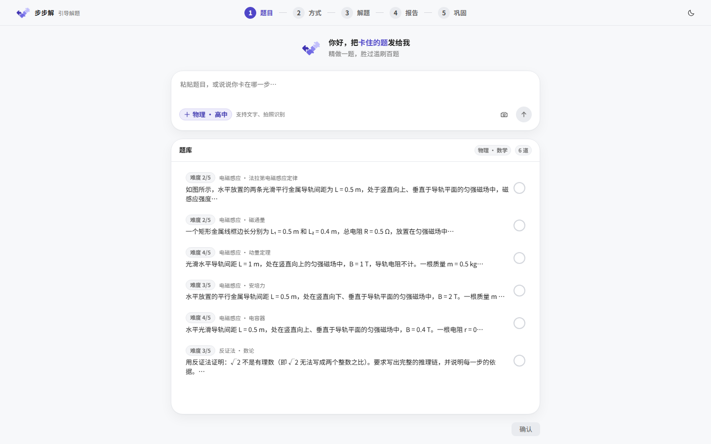
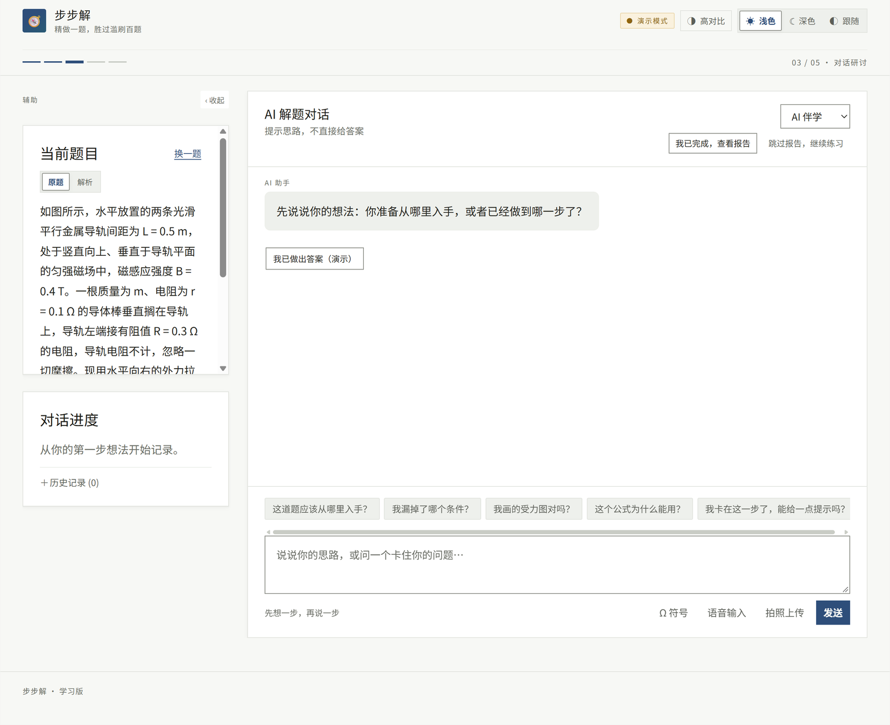
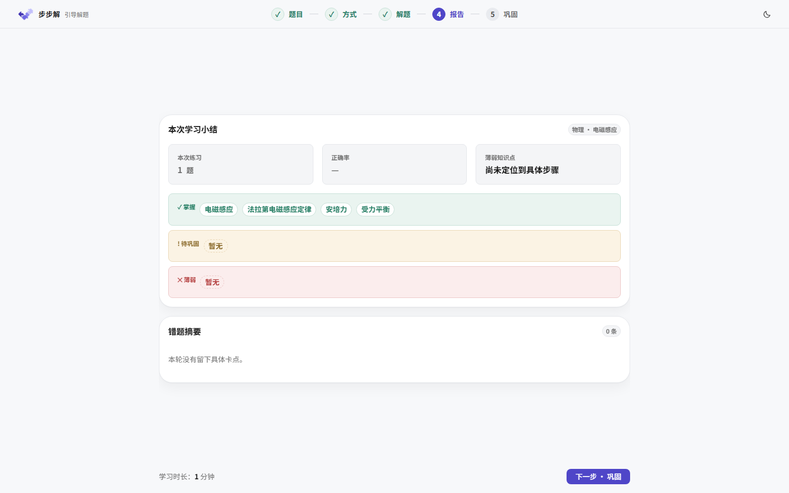

# 步步解

> 精做一题，胜过滥刷百题。

面向中学生重难题的引导式解题助手。它不直接回答“这道题怎么做”，而是先读懂学生已经想到哪一步，
再给出一句恰好够用的提示，逼学生自己往下走一步。

**五页流程：题目 → 方式 → 解题 → 报告 → 巩固。** 步骤条五页随时可点，某页还没数据就进空态给一句提示，不把人弹回上一页。

**当前只开放「自主训练」**：AI 伴学标着「暂未更新」，暂时点不了；任何方式都不给答案。

[](package.json)
[](package.json)
[](test/run.js)
[](LICENSE)

仓库地址：<https://github.com/shilohjun/ai-guided-tutor>

<p align="center">
  
  
  <br />
  
</p>

---

## 回答规范升级（yangshuhan）

学生回复尽量60–100字、硬上限150字；三级提示逐步补充信息，完整消息统一检查。见[改动与验收说明](docs/07-prompt-upgrade.md)、[当前提示词](docs/02-prompt-spec.md)及[分支使用说明](docs/08-branch-workflow.md)。新增17项回归使用 `npm run test:reply-policy`，原有7项页面契约失败保留。

## 目录

- [现在是什么](#现在是什么)
- [核心机制](#核心机制)
- [学习闭环](#学习闭环)
- [快速开始](#快速开始)
- [配置](#配置)
- [可用脚本](#可用脚本)
- [分享预览版](#分享预览版)
- [测试与评测](#测试与评测)
- [项目结构](#项目结构)
- [API 一览](#api-一览)
- [部署](#部署)
- [已知边界](#已知边界)
- [文档](#文档)
- [许可](#许可)

---

## 现在是什么

- **五页流程**：题目 → 方式 → 解题 → 报告 → 巩固。步骤条五页随时可点；某页还没数据就进空态并给一句提示，不会把人弹回上一页。
- **真实题库**：6 道内置题；点选走 `/api/problem`，粘贴文字走 `/api/problem/import`，拍照走 `/api/ocr`。
- **真实对话**：`/api/chat` 接入真实模型；学生消息、AI 提示、对话进度、完成判定都来自服务端。
- **真实报告**：`/api/report` 返回独立完成度、引导轮次、卡点、深层问题、推荐与行动建议。
- **公式卡**：`/api/formula` 在 L3 之后按知识点下发；报告单独统计公式卡次数并扣独立完成度。
- **巩固页**：重做本题 / 用 `GET /api/related` 挑同知识点的题。
- **只有自主训练**：`/api/health` 的 `capabilities.modes` 只登记 `self_training`；AI 伴学禁用并标「暂未更新」，服务端收到 `ai_companion` 直接返回 400。

---

## 核心机制

### 一、卡点分类体系

「学生卡住了」不是一个状态，而是七种完全不同的处境。诊断层必须把它们分开，
否则提示会答非所问——对“漏了前提”的学生追问“用什么规律”，等于白问。

| `stuckKind` | 学生处境 | 策略取向 |
|---|---|---|
| `not_started` | 还没形成思路 | 只做结构化澄清，不给任何方向 |
| `knowledge_gap` | 不知道用哪个规律 | 问过程性质，不点名公式 |
| `precondition_gap` | 知道规律但漏了前提 | 条件追问（最高价值场景） |
| `direction_lost` | 知道规律但走不下去 | 指关系、不指式子 |
| `execution_error` | 思路对但算错了 | 邀请自查，必要时局部示范 |
| `dead_end_path` | 自己已发现这条路走不通 | 引导换工具，而不是继续算 |
| `finished` | 已接近完成 | **AI 应当沉默** |

诊断结果必须能指回学生原话（`evidenceQuotes`），否则该次定位不被采信、
降级为“先澄清”。宁可先问一句“我理解得对吗”，也不对着错误的步骤给提示。

### 二、分层提示机制

提示分四层递进，**最多一次只升一级**：

| 层级 | 形态 | 内容 |
|---|---|---|
| `L0` | 结构化澄清 | 帮学生把话说清楚，不算提示 |
| `L1` | 条件追问 | 只问，不指方向 |
| `L2` | 方向提示 | 指出该看哪个量、哪个关系，但不给表达式 |
| `L3` | 降级示范 | 示范一步“动作”，不给数值结果 |

两条护栏不依赖模型自觉，而是在决策层强制生效：

- **禁止跳级**：按历史“连续前缀”判断可达层级，L3 要求历史里出现过 L2，L2 要求出现过 L1。
- **禁止原地打转**：同一层级在同一卡点已给过 2 次时，允许升一级；L3 再重复则要求学生复述自己的下一步。

### 三、防泄题机制

交付给学生的每一句话，都要先过七类确定性检查：

| # | 拦截内容 | 生效层级 |
|---|---|---|
| 1 | 数值答案（含“一库仑”这类中文数字说法） | 全部 |
| 2 | 解法性公式的完整表达式 | 全部（L3 允许“半边”） |
| 3 | 超出声明层级的内容（L1/L2 出现公式形态） | L0–L2 |
| 4 | 解法倾倒：编号步骤 > 2 个，或推导箭头 > 2 个 | 全部 |
| 5 | 收口句式：“所以答案是 / 最终结果 / 因此可得” | 全部 |
| 6 | 跑题：引用了本题不存在的概念 | 全部 |
| 7 | **说出解题核心结论**（如“导体棒是电源，r 是内阻”） | L0–L2 |

第 7 类判据是「**指派**」而非「提及」：

- ✅ 允许：*「谁是提供电动势的那一部分？它自身有没有电阻？」*
- ❌ 拦截：*「导体棒相当于电源，它的电阻就是内阻。」*

| 检查函数 | 违规 `kind` | 拦截内容 |
|---|---|---|
| `checkAnswerLeak` | `answer_in_text` | 数值答案 |
| `checkFormulaLeak` | `formula_leak` | 解法性公式表达式 |
| `checkLevelOverflow` | `level_overflow` | 超出声明层级的内容 |
| `checkSolutionDump` | `solution_dump` | 解法倾倒 |
| `checkConclusion` | `final_conclusion` | 收口句式 |
| `checkConceptDomain` | `concept_out_of_domain` | 跑题概念 |
| `checkSolutionInsight` | `solution_insight` | 解题核心结论 |

详细契约见 [`docs/01-hint-ontology-and-contract.md`](docs/01-hint-ontology-and-contract.md)
与 [`docs/02-prompt-spec.md`](docs/02-prompt-spec.md)。

---

## 学习闭环

1. **题目**：内置题库 / 文字导入 / 拍照识别；读题产出摘要、关键条件、知识点与知识图谱。
2. **方式**：选自主训练（目前唯一可用的方式）；AI 伴学入口还在，标「暂未更新」。
3. **解题**：学生先交出思路；服务端定位卡点、选层级、过守卫；左栏步骤条显示走到第几步，只给走过的步骤命名。
4. **报告**：三色档（掌握 / 待巩固 / 薄弱）+ 错题摘要 + 学习时长；会话过期时给琥珀色提示而不是空白。
5. **巩固**：重做这道题，或挑同知识点的题继续。

引擎的默认是"先让学生自己写"：只有学生明确求助（点提示、说"卡住了"）才升级到 L1–L3 分层提示，
只说出思路时保持沉默。第 3 页左侧的步骤条与右栏对话共用同一份 `progress`，
已走过的步骤才有名字（服务端按 `safeStepRef` 降级风险步骤）。

页面支持 `?p=2`–`?p=5` 直接落到某一页（预览与截图用）。

---


## 快速开始

需要 **Node.js 20 或更高版本**。项目**零运行时依赖**，无需 `npm install`：

```bash
git clone https://github.com/shilohjun/ai-guided-tutor.git
cd ai-guided-tutor
npm start
```

然后打开 <http://127.0.0.1:5173>。

### 填 Key

复制 `.env.example` 为 `.env`，把需要的项填上（改完重启 `npm start` 生效）：

```bash
cp .env.example .env
```

`.env` 已在 `.gitignore` 里，不会被提交。

两个入口：

| 路径 | 内容 |
|---|---|
| `/` | 新五页界面（`public/index.html`），已接真实接口 |
| `/classic.html` | 旧壳的保底副本，计划保留一个版本后下线；它加载的 `/api/demo/*` 与 `/api/teacher/*` 已下线，旧壳里的演示/教师入口会报错 |

新五页与接口的对应关系：

| 页面 | 接口 | 说明 |
|---|---|---|
| ① 题目 | `GET /api/problems`、`POST /api/problem/import`、`POST /api/ocr` | 题库与预览来自注册表；粘贴文字走读题；拍照只把图变成文字，学生核对后再导入；未配凭据时按钮变灰并说明原因 |
| ② 方式 | `GET /api/health`（`capabilities.modes`） | 当前只有 `self_training` 可点；`ai_companion` 禁用并标「暂未更新」，服务端收到也直接返回 400 |
| ③ 解题 | `GET /api/problem`、`POST /api/chat` | 左栏题干/图示/已知/求 + 步骤条；每轮回复、步骤进度、已走过步骤名都来自引擎 |
| ④ 报告 | `GET /api/report` | 三色档、错题摘要、学习时长；会话过期时给明确提示而不是空白 |
| ⑤ 巩固 | `GET /api/related`、`GET /api/problem` | 重做本题 / 同类题再练（按共享知识点筛，最多 6 道）；选中同类题即开新会话 |

没有配置模型 Key 也能完整跑通——引擎会自动降级到**离线规则桩**，
页面、测试、评测全部可用，只是提示文案来自规则而不是模型。

---

## 配置

复制 `.env.example` 为 `.env` 后按需填写。`.env` 已在 `.gitignore` 中，不会被提交。

| 变量 | 说明 | 默认 |
|---|---|---|
| `LLM_API_KEY` | 模型 API Key，留空即走离线规则桩 | 空 |
| `LLM_BASE_URL` | OpenAI 兼容接口地址（末尾不带 `/chat/completions`） | `https://api.deepseek.com/v1` |
| `LLM_MODEL` | 模型名 | `deepseek-chat` |
| `LLM_TIMEOUT_MS` | 单次请求超时，理科长题建议 ≥ 30s | `45000` |
| `PORT` / `HOST` | 本地服务地址 | `5173` / `127.0.0.1` |
| `ALIYUN_OCR_APPCODE` | 拍照识题凭据，留空则该入口显示“未启用” | 空 |

### 接入模型

任何兼容 OpenAI Chat Completions 协议的服务都可以：

```env
LLM_API_KEY=你的API密钥
LLM_BASE_URL=https://api.deepseek.com/v1
LLM_MODEL=deepseek-chat
```

### 拍照识题

需要 **AppCode**（是 AppCode，不是 AppKey / AppSecret），改完 `.env` 重启：

```env
ALIYUN_OCR_APPCODE=你的AppCode
ALIYUN_OCR_PROVIDER=marketplace
```

计费按**成功调用次数**（题目识别约 0.083 元/次），且没有“额度用完自动停”的保护。
没配凭据时，首页相机图标变灰、`title` 写明缺哪个变量。

图片识别**按次计费**，所以流程刻意做成「识别 → 回填输入框 → 学生确认 → 再读题」，
避免识别错误悄悄带偏整条链路。

---

## 可用脚本

```bash
npm start          # 启动本地服务
npm run dev        # 监听文件变化并重启
npm test           # 全部单元测试 + UI 令牌审计（当前 311 个注册用例）
npm run eval       # 离线评测（19 场景，无需 Key）
npm run eval:llm   # 使用 .env 中配置的模型重跑评测
npm run ocr:path   # 探测 OCR 链路连通性
npm run all        # 测试 + 离线评测

npm run ui:audit      # 样式规范审计（字号/字重/间距/嵌套圆角/饱和度）
npm run ui:shots      # 5 页 + 深色截图，输出到 preview/

npm run preview:build   # 打包单文件离线预览版 → preview/preview.html
npm run preview:verify  # 用 file:// 打开预览版跑一遍链路验收
npm run preview:capture # 重新抓取演示数据（需先 npm start）
```

---

## 分享预览版

`preview/preview.html` 是**单文件、零依赖**的演示版：发给别人后双击就能看，
不需要 `npm start`，也不需要联网。

```bash
npm start                 # 先起服务，供抓取真实返回
npm run preview:capture   # 抓一份真实会话 → scripts/demo-data.json
npm run preview:build     # 内联数据 + 拦截 fetch → preview/preview.html
npm run preview:verify    # file:// 打开验收
```

- 业务代码与线上是同一份（`public/index.html`），预览版只在主脚本前加了一层
  `fetch` 拦截，把 `/api/*` 用内置数据就地应答 —— 所以不会出现"演示能点、线上不能点"。
- 支持深链：`preview.html?p=3` 直达解题页；`preview.html?p=3&auto=1` 自动把 5 轮对话
  演完并跳到报告页（适合投屏或录屏）。
- 演示数据来自真实服务（`engine=offline-stub`）：5 轮对话、报告卡点、题库列表都是
  抓下来的原始返回，不是手写文案。接入真模型后重跑上面三步即可换成真实 AI 输出。

---

## 测试与评测

```bash
npm test
```

当前注册 **311 个用例，全部通过**。`npm test` 跑完测试后会接着跑
`scripts/audit-ui-style.js`：它把设计令牌（间距四档、字号四档、圆角两档、
语义色）做成可执行规则，样式一跑偏就报出来 —— 只靠人眼看不住。

前端契约按**新版单文件**（`public/index.html`）检查：五页流程、页二的模式能力位、
页三"做到第几步"、页五三张卡、答案与教师功能不留入口，都在 `test/ui.test.js` 里。
`test/docs.test.js` 会从源码实际数出卡点种类、守卫类别与用例总数，再回头核对本文档。

```bash
npm run eval
```

在 **19 个教研标注场景**（物理 15、数学 4）上跑离线评测，输出泄题率、跳级率、
定位命中率、错因命中率等指标。切到真模型后**必须重跑**：

```bash
npm run eval:llm
```

> 评测口径与指标定义见 [`docs/03-evaluation-spec.md`](docs/03-evaluation-spec.md)。

---

## 项目结构

```text
public/
  index.html            新五页（单文件：markup + 内联 CSS + 内联 JS）
  classic.html          旧壳保底副本，计划保留一个版本后下线
  app.js / styles.css   旧版页面代码，当前不引用，正在清理
  shell.js              旧壳入口脚本（只被 classic.html 加载）
  shell.css / shell-overrides.css / youth.css   旧壳样式
  mathinput.js          旧壳的符号插入
src/core/
  engine.js             主流程编排
  locate.js             卡点定位
  route.js              分层提示与两条硬护栏
  guard.js              防泄题七类检查
  intake.js             读题（文字 → 结构化题目）
  ocr.js                拍照识题
  report.js             学习报告与会话记录
  formula-cards.js      公式卡知识点表
src/server/             API 路由（本地与 serverless 共用）
test/                   自动化测试（自研极简运行器，零依赖）
docs/                   设计文档与截图
api/                    Vercel Serverless API 入口
showcase/               单文件成果展示页（独立于应用）
v3.html                 设计参考稿
DESIGN-TOKENS.md        设计 token 与可访问性说明
```


---

## API 一览

本地与 Vercel 环境复用同一份路由（`src/server/router.js`），行为不会漂移。

| 方法 | 路径 | 说明 |
|---|---|---|
| `GET` | `/api/health` | 健康检查、当前运行模式、`capabilities.modes`（哪些做题方式能点） |
| `GET` | `/api/problems` | 内置题目列表 |
| `GET` | `/api/related?id=` | 同知识点的同类题（最多 6 道；一道都没有时退化成题库其余题） |
| `GET` | `/api/problem?id=` | 单个题目（学生可见版本） |
| `POST` | `/api/problem/import` | 题目文字 → 结构化题目 |
| `POST` | `/api/ocr` | 题目照片 → 题干文本 |
| `POST` | `/api/chat` | 一轮引导对话（已过滤，不含解题路径与答案；`ai_companion` 返回 400） |
| `GET` | `/api/report?sessionId=` | 学生学习报告 |
| `POST` | `/api/formula` | L3 之后按知识点取公式卡 |
| `POST` | `/api/eval` | 触发评测 |
| `POST` | `/api/reset` | 重置会话 |

---

## 部署

仓库包含 Vercel 部署配置。**公开 Demo 默认关闭真模型与拍照 OCR**——
这个决定写在 `api/index.js` 里，而不是靠部署时“记得别配”：

- 公网服务带着 API Key 跑真模型，等于把额度挂出去；
- 拍照识题按次计费，删 Key 也拦不住已经发出去的调用；

确实需要在公网演示某一环时，必须显式设置对应开关（如 `PUBLIC_DEMO_ALLOW_OCR=1`），
并先阅读 `api/index.js` 中的限制说明。

### 三种可选形态

默认是"安全优先"的形态。想要更完整的演示效果，按需往上开一档：

| 形态 | 需要的环境变量 | 拿到的人能用到 |
|---|---|---|
| **默认**（不配任何变量） | 无 | 只有离线规则桩；OCR 关闭 |
| **满血公开** | `PUBLIC_DEMO_FORCE_OFFLINE=0`<br>`PUBLIC_DEMO_ALLOW_OCR=1` | 真模型 + 拍照识题。**任何拿到链接的人都在消耗额度** |
| **口令门**（推荐） | 上面两个都不配<br>`DEMO_ACCESS_CODE=你的口令` | 带对口令（`?code=` 或请求头 `x-demo-code`）才是真模型 + OCR；<br>不带口令退回离线桩，页面照常可浏览 |

关于**口令门**的两个实现细节，因为它们直接决定它是否真的安全：

- **口令比较在服务端做**，用的是定时安全比较，前端拿不到口令本身；
  浏览器取到口令后存进 `localStorage` 并把它从地址栏抹掉，避免截图/投屏/转发泄露。
- **凭据按请求隔离**，不是改 `process.env`。后者是进程级的，两种形态共存时
  并发一交错就会串号——没带口令的请求会白捡上一个请求留下的真模型。
  实现见 `src/server/router.js` 的 `envFor()`（`AsyncLocalStorage`）。

> ⚠️ 选"满血公开"之前先想清楚成本：拍照识题**按成功调用次数计费**（约 0.083 元/次），
> 且没有"额度用完自动停"。建议先在阿里云控制台给该 AppCode 设额度上限或告警。

### 三个平台的入口

同一份业务逻辑与同一份判定，跑在三个 serverless 平台上：

| | Vercel | Cloudflare Workers | 腾讯云 CloudBase |
|---|---|---|---|
| 入口文件 | `api/index.js`（Node 的 `req`/`res`） | `api/worker.js`（Fetch API） | `src/server/cloudbase-handler.js`（云函数事件） |
| 配置文件 | `vercel.json` | `wrangler.jsonc` | `cloudbaserc.json` |
| 静态资源 | `outputDirectory: public` | `assets.directory: ./public` | 静态托管（`staticstore`） |
| 凭据来源 | `process.env` | 绑定的 Secret（`wrangler secret put`） | 云函数环境变量（`tcb fn config update`） |
| 部署命令 | `npx vercel deploy --prod` | `npx wrangler deploy` | `tcb hosting deploy ./public` + `tcb fn deploy bubujie-api` |

**为什么需要三份入口**：不是因为技术栈不同，而是因为网络可达性不同。
`*.vercel.app` 被 DNS 投毒成 `157.240.x.x`（Facebook 的地址段），
`*.workers.dev` 被投毒成 `128.121.x.x`，两条域在国内都解析不到真地址 ——
带代理能 curl 通，**不代表用户能打开**。所以最后落在腾讯云：域名解析到 `124.223.146.214`
这类上海节点，不经代理直连首页约 0.4 秒、`/api/chat` 约 3 秒。

**CloudBase 走的是单域方案**，不是"静态托管 + 跨域接口"：

```
同一个域名  xxx.service.tcloudbase.com
  /      → 静态托管 staticstore      （public/ 里的 8 个文件）
  /api   → 云函数 bubujie-api        （与本地、Vercel 同一份 router）
```

踩过的坑写在 `src/server/cloudbase-handler.js` 的注释里，这里记结论：
把 `/` 也绑到云函数时，HTTP 访问服务对非 `/api` 路径直接回 404（**响应体是 0 字节**，
看起来像函数里读文件失败，其实是网关自己拒的）。`/` 必须指向 `STATIC_STORE`，
`/api` 指向 SCF，同域就没有 CORS、前端一行不用改。

三处刻意的复用，防止平台之间行为漂移：

- **口令门与凭据裁剪** → `src/server/demo-gate.js`，三个入口都只调 `buildRequestContext()`
- **业务逻辑** → `src/server/router.js`，连本地 `server/server.js` 也是同一份
- **函数打包** → `scripts/build-cloudbase.mjs`，把 CJS 入口、ESM 的 `src/`、`public/` 铺成
  `dist-cloudbase/bubujie-api/`（根 `package.json` 是 `"type": "module"`，云函数要 CJS，
  所以入口用动态 `import()` 接，两边都不用改源码）

翻译层的正确性各有测试：`test/worker-adapter.test.js`（9 条，含请求体穿桥）、
`test/cloudbase-adapter.test.js`（15 条，含网关两种 path 形态、base64 body、静态资源命中）。

⚠️ 部署前先把 `compatibility_date` 保持在 `2025-09-01` 或更新：
`src/core/env.js` 在模块顶层 import 了 `node:fs`（只用来读可选的 `.env`），
更早的日期不会默认提供该模块的实现，构建会直接失败。

`showcase/` 是**独立的单文件展示页**，由
[`.github/workflows/pages.yml`](.github/workflows/pages.yml) 发布到 GitHub Pages；
它与可交互的应用页面相互独立。发布前需在仓库 Settings → Pages 中把 Source 设为
**GitHub Actions**。

---

## 已知边界

**现在这组数据证明的是「安全」，不是「有用」。**

- 它能证明：在 19 个场景与压力测试下，引擎**守得住不给答案**（泄题率 0%、跳级率 0%）。
- 它**还不能**证明：提示对学生的实际学习效果。这需要教研老师盲评真实对话才能判断。

其他已知限制：

| 限制 | 说明 |
|---|---|
| 测试状态 | 311 个注册用例全部通过（含 UI 令牌审计） |
| AI 伴学 | 未上线：`capabilities.modes` 只有 `self_training`，接口对 `ai_companion` 返回 400 `MODE_UNAVAILABLE` |
| 公式卡范围 | 按知识点表匹配；导入题的知识点不在表内时不发卡 |
| 场景集规模 | 19 个场景且由人编写，覆盖不了真实学生的表达多样性 |
| 长会话稳定性 | 场景集最长 3 轮，尚未做 10+ 轮疲劳测试 |
| 跨学科泛化 | 主要验证物理电磁感应，数学覆盖有限 |
| 图形类题目 | OCR 只识别文字，读不懂受力图、电路图与几何图 |
| 会话持久化 | 服务端会话存进程内存，重启后报告可能失效；浏览器不保存学习历史 |
| 教学质量 | 未做教研盲评；这是下一阶段最重要的工作 |

---

## 文档

| 文档 | 内容 |
|---|---|
| [`01-hint-ontology-and-contract.md`](docs/01-hint-ontology-and-contract.md) | 提示本体与接口契约 |
| [`02-prompt-spec.md`](docs/02-prompt-spec.md) | Prompt 规范 |
| [`03-evaluation-spec.md`](docs/03-evaluation-spec.md) | 评测标准与方法 |
| [`04-intake-and-views.md`](docs/04-intake-and-views.md) | 读题链路、能力位与五页流程 |
| [`05-ocr-feasibility.md`](docs/05-ocr-feasibility.md) | 图片识别可行性评估 |
| [`06-marketplace-ocr-integration.md`](docs/06-marketplace-ocr-integration.md) | 云市场题目 OCR 接入研究 |
| [`07-prompt-upgrade.md`](docs/07-prompt-upgrade.md) | 回答规范升级与验收 |
| [`08-branch-workflow.md`](docs/08-branch-workflow.md) | 分支使用说明 |
| [`DESIGN-TOKENS.md`](DESIGN-TOKENS.md) | v3 设计 token 与可访问性说明 |
| [`showcase/`](showcase/) | 项目成果展示页 |

---

## 许可

项目当前标记为**未授权公开许可**（`UNLICENSED`）。如需复用或分发代码，请先联系项目作者。
