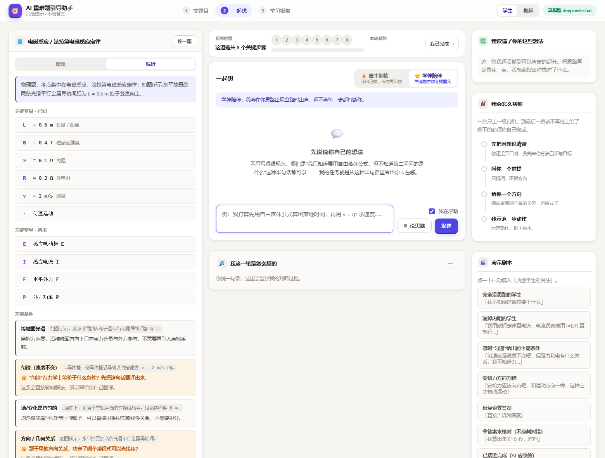
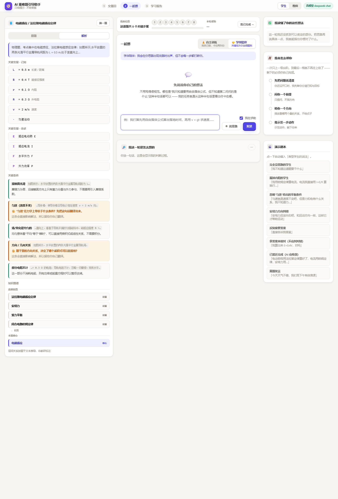
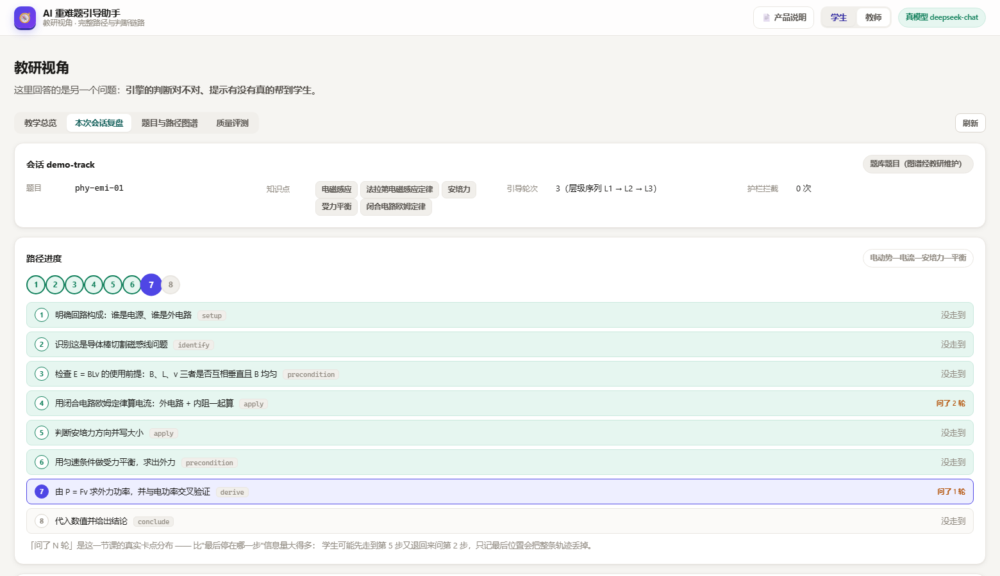
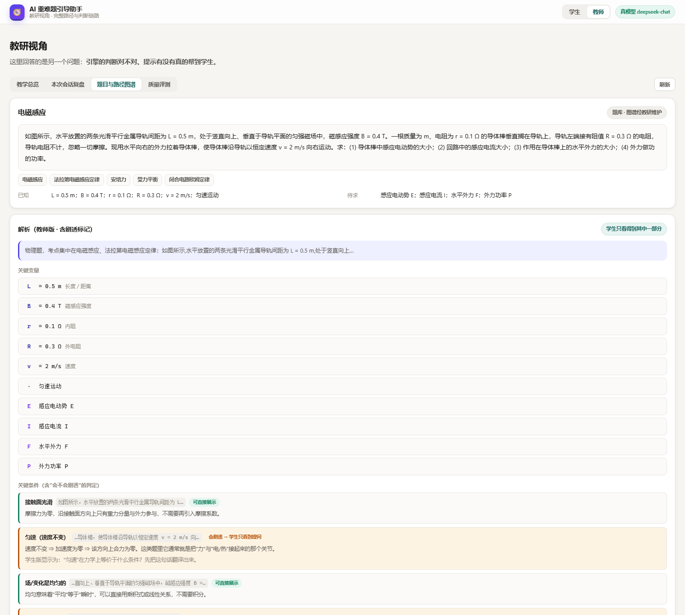
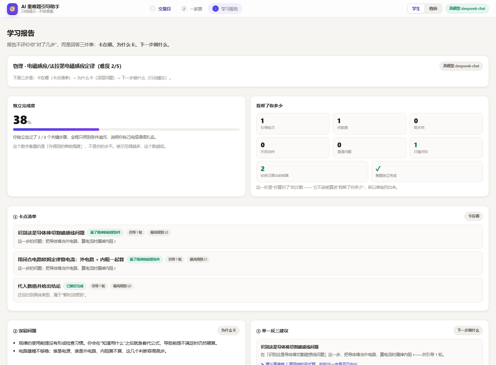

# AI 重难题引导助手 · 提示引擎

> **目标能力**：让 AI 看懂学生的解题思路，判断他卡在哪一步，然后**只给提示、不给答案**。
>
> **当前范围**：proposal 里的第 ②③ 环节（看懂思路 → 分层引导 → 学习报告），
> 支持**任意题目文字导入**（不再限定在题库里），首批题库为**物理·电磁感应 + 数学证明**。
>
> **交付形态**：一个可直接打开的网页（学生视图 3 页 + 教师视图 1 页）+ 可复现的测试与评测。

---

## 快速开始（零依赖，不需要 npm install）

```bash
# 启动 Demo
node server/server.js
# 打开 http://127.0.0.1:5173
```

```bash
# 跑测试（219 个用例）
node test/run.js

# 跑离线评测（19 个典型学生场景：15 物理 + 4 数学）
node scripts/eval.js

# 跑真模型评测（需要 .env 里的 Key）
node scripts/eval.js --adapter llm
```

只要求 **Node ≥ 20**。没有 `node_modules`，没有构建步骤 ——
这个 PoC 会被交到教研/企业手里跑，"clone 下来就能开"比什么都重要。

### 两分钟看到全部能力

1. 打开页面，在「粘贴题目文字」里贴一道**题库里没有的题**（任何学科）→ 点「读懂这道题」
2. 看到"考到的知识点 + 解题路径已建档 N 步" → 点「开始一起想」
3. 说一句你自己的思路 → 看右侧「我这一轮是怎么想的」（引擎判断链路）
4. 切到右上角**教师视图** → **直接点「进入」**（本地无需口令）→ 看完整路径图谱、错因命中、逐轮复盘

---

## 部署（三种形态）

同一套代码支持三种部署方式。`src/server/router.js` 是共用的业务逻辑，
**本地服务与 serverless 函数不会漂移成两套行为**。

### 形态一：本地运行（开发 / 答辩现场）

```bash
node server/server.js
```

### 形态二：公开在线 Demo（Vercel，推荐）

仓库已包含 `vercel.json` 与 `api/index.js`，零配置即可部署：

```bash
npx vercel        # 首次会引导登录
npx vercel --prod # 正式发布
```

或在 Vercel 网站导入本仓库，**无需改任何设置**。

**公开 Demo 会强制使用离线规则桩**（`api/index.js` 里显式清空 Key），原因：

- 公网服务带着 API Key 跑真模型 = 把额度挂出去
- 本 PoC 的安全保证（7 类守卫、层级护栏）全在决策层与守卫层，**与模型能力无关** ——
  离线桩下安全指标同样是 0

所以在线 Demo 与本地真模型演示，**安全性完全一致，只是话术更模板化**。

对应的两个可预期差异，提前说明清楚（不然会以为是 bug）：

| 能力 | 本地（真模型） | 公开 Demo（离线桩） |
|---|---|---|
| 导入新题目 | 真读题：知识点 + 多路径图谱 | 通用六步骨架（页面上会写明"未启用模型读题"） |
| 提示话术 | 贴合学生本次发言 | 更模板化（仍分层、仍不泄题） |
| 教师视图 | **本地默认直接进**；配了 `TEACHER_KEY` 才需要口令 | **一律关闭**（403） |

> ⚠️ serverless 的两个已知局限，都写在明处：
> - **会话**存在进程内存里，冷启动或换实例会丢上下文，
>   因此「学习报告」页在长时间间隔后可能提示会话失效（已做友好降级）。
> - **导入的题目**同样在内存里（TTL 6 小时，上限 200 道），冷启动后需要重新导入。
>   因为题目 id 是**题干内容哈希**，重新导入会得到同一个 id，前端不需要知道发生过回收。
>
> 本地运行不受这两条影响。

### 形态三：单文件演示页（GitHub Pages）

`showcase/` 目录是**零依赖的单文件演示文稿**，适合直接发布成公开链接。

**注意：不能用「Deploy from a branch」模式。** 该模式的目录下拉框
只提供 `/ (root)` 和 `/docs` 两个选项，**不支持任意子目录** ——
所以在里面搜不到 `/showcase`。正确做法是用 Actions 模式：

1. 仓库 → **Settings → Pages** → Source 选 **`GitHub Actions`**
   （不要选 `Deploy from a branch`）
2. 工作流已随仓库提供：`.github/workflows/pages.yml`，
   它把 `showcase/` 作为站点根目录发布
3. 推送到 `main` 后，**Actions** 标签页会出现 `Deploy showcase to Pages`，
   跑完即可在 **Settings → Pages** 顶部看到链接

链接形如 `https://<用户名>.github.io/<仓库名>/`，打开即是那 11 页成果，
能翻页、能 `Ctrl/Cmd+P` 导出 PDF，读者不需要懂代码、不需要装任何东西。

> 该工作流的触发条件已限制为 `showcase/**` 或工作流文件本身变更，
> 因此改代码不会触发重新部署。

---

## 我要的 Key 是什么

一个**OpenAI 兼容协议的 chat completions Key**。国内任选一条：

| 供应商 | `LLM_BASE_URL` | `LLM_MODEL` | 备注 |
|---|---|---|---|
| DeepSeek | `https://api.deepseek.com/v1` | `deepseek-chat` | 便宜、中文理科强，**当前使用中** |
| 阿里百炼/通义 | `https://dashscope.aliyuncs.com/compatible-mode/v1` | `qwen-plus` | `qwen-vl-max` 可读题目照片 |
| 智谱 GLM | `https://open.bigmodel.cn/api/paas/v4` | `glm-4-plus` | `glm-4v` 可读题目照片 |

**接入方式（改一个文件，不动代码）**：

```bash
cp .env.example .env
# 编辑 .env，填 LLM_API_KEY / LLM_BASE_URL / LLM_MODEL
node server/server.js
```

还要在 `.env` 里设置一个**教师视图口令**（教师视图靠它隔离，见下文）：

```bash
TEACHER_KEY=<你自己设一串>
```

启动日志会显示当前是"真模型"还是"离线规则桩"、读题能力是否可用、教师视图是否已启用。

> **没 Key 也完全能跑。** 引擎会自动降级到离线规则桩，
> 测试、评测、Demo 全部可用。评测里的安全指标（泄题率等）与模型能力无关，
> 它们在离线模式下同样必须为 0 —— 因为这些保证来自**决策层与守卫层**，不来自模型。

---

## 这个 PoC 的核心主张

**"不给答案"不能靠 Prompt 里写一句"请不要给答案"来保证，必须做成工程约束。**

因此架构被切成三层职责：

```
LLM（观察员）              规则代码（决策者）          守卫（把关者）
────────────────          ──────────────────         ──────────────
学生说了什么                该给几级提示                有没有泄题
落在哪一步                  用什么策略                  有没有跑题
像哪类错因                  允许引用哪些概念            有没有越界
```

**模型负责"懂"，代码负责"分寸"。**

为什么这样切：

| 如果交给模型 | 会怎样 |
|---|---|
| 自行决定给几级提示 | 学生一喊难就直接给到最高级别示范（等于变相给答案） |
| 自行判断"什么算给了答案" | 换个说法、给近似值、给公式，100 种方式绕过 |
| 自述"我理解你了" | 定位错了无从发现，而**错误的提示比不给提示伤害更大** |
| 自行决定"什么是答案" | 导入新题目时没有任何比对基准，守卫形同虚设 |

最后一行是本轮新增的：**读题链路同样遵守这条切法** ——
模型只负责"读懂题目"，产出结构化图谱；"什么算说出了答案"
（三组指纹）虽然由它起草，但必须经过清洗与兜底，且缺失时要**显式告警**。

---

## 三条链路，同一个切法

```
        ┌──────────── 模型（只做它擅长的）────────────┐
读题    看懂这道题：知识点 / 路径 / 错因 / 参考答案      → 代码校验 + 指纹兜底
听懂    看懂这个学生：说了什么 / 落在哪一步 / 像哪类错因  → 双通道交叉校验
说话    生成一句提示（受层级与白名单约束）              → route 定层级 + guard 过关 + voice 关
        └──────────────────────────────────────────────┘
                          ↓
        出口断言：guard.passed === true，否则直接抛错
                          ↓
        白名单投影：学生版 / 教师版是两次独立投影，不是同一份数据加打码
```

---

## 目录结构

```
├── src/core/                  引擎核心（与 UI 完全解耦，可独立测试）
│   ├── types.ts               类型契约（本文档的可执行版本）
│   ├── problems.data.js       题库：5 道电磁感应题 + 1 道数学证明题
│   ├── text.js                归一化 + 中文短语匹配 + 小问编号剥离  ← 最易出错，务必看测试
│   ├── llm.js                 LLM 适配层：observe / draft / **读题** 三件事
│   ├── intake.js              **读题链路**：任意题干 → 结构化题目（含指纹兜底与降级）
│   ├── registry.js            题库 + 导入题目的统一注册表（TTL 回收，内容哈希做 id）
│   ├── locate.js              双通道定位 + 卡点性质分类
│   ├── route.js               层级决策（AI 无权修改）+ 两条硬护栏
│   ├── guard.js               防泄题守卫（7 类检查 + 降级重写）
│   ├── engine.js              编排：observe → understand → route → draft → guard
│   ├── prompt.js              学生可见文本：消息组装 + voice 关 + **学生版判断链路投影**
│   ├── report.js              学习报告聚合（同时存教研复盘所需的完整字段）
│   ├── verify.js              **答案判定**：学生自己答对了就确认，答错了不说话
│   └── eval.js                评测场景集与指标计算
│
├── src/server/router.js       API 路由 + **学生/教师载荷分流**（教师端点需 TEACHER_KEY）
├── server/server.js           HTTP 服务（零依赖）
├── public/                    Demo 前端（学生 3 页 + 教师 1 页，零依赖 ES module）
├── test/                      219 个测试（含读题、答案判定、前端契约、密钥不外泄）
├── scripts/eval.js            评测入口
└── docs/                      接口契约 / Prompt 规范 / 评测标准 / **读题与视图隔离**
```

---

## 页面结构（学生视图 3 页 + 教师视图 1 页）

| 视图 | 页面 | 内容 | 状态 |
|---|---|---|---|
| 学生 | ① 交题目 | **粘贴任意题目文字**（真模型读题）+ 拍照入口（未接）+ 题库 | 完成 |
| 学生 | ② 一起想 | **核心**：左=题目与解析（原题/解析开关）｜中=对话｜右=我的状态 | 完成 |
| 学生 | ③ 学习报告 | 卡点清单 / 深层问题 / 下一步行动 | 完成 |
| 教师 | 教研视角 | 知识点 / 完整路径图谱 / 错因命中 / 逐轮复盘 / 引擎完整 trace / 质量评测 | 完成 |








---

## 题目解析：原题 ⇄ 解析

每道题都有一个**开关键**，在「原题」和「解析」之间切换 —— 这是学生最常用的一个动作：
先看题，再想看它考什么。

解析由 `src/core/analysis.js` 产出，**题库题与导入题目走同一条代码路径**
（题库题没有模型给的解析，就全部按题干与图谱派生）：

| 解析内容 | 说明 |
|---|---|
| **关键变量** | 已知量逐条拆成 `符号 / 值 / 单位 / 它是什麼`；待求量单列 |
| **关键条件** | 题干里"一句话改变整道题"的说法（由静止 / 光滑 / 匀速 / 恰好 / 足够长…），每条都带"它为什么重要" |
| **知识图谱** | 本题涉及的知识点、它们的先后关系、哪些是本题核心 |

### 解析里最要紧的一条：它会剧透，所以必须分级

「匀速 ⇒ 合力为零」这句话，既是**最该讲的解析**，也是**本题的答案**
（它就是那道题的 `solutionInsight`）。所以每条条件都会被算一个 `reveals` 标记：

| | 学生看到的 | 教师看到的 |
|---|---|---|
| 不剧透的条件（如"接触面光滑"） | 完整含义 | 完整含义 |
| **会剧透的条件**（如"匀速"） | **一句提问**："'匀速'在力学上等价于什么条件？先把这句话翻译出来。" | 完整含义 + `会剧透 → 学生只看到提问` 标记 |

判定用了两条判据，抓的是两类不同的泄漏：

1. **结论型**：命中 `solutionInsights` / `formulaFingerprints` —— 与守卫用**同一套指纹**，
   所以不会出现"解析里能说、提示里不能说"的口径矛盾。
2. **前提型**：命中了**只存在于解题步骤里的说法**（步骤标题 / 定位关键词 / 路径前提）。

> 第 2 条是**测试逼出来的**。一开始只做了第 1 条，结果 `test/analysis.test.js`
> 的反向断言当场失败：几何条件那条解释里写了"切割式要求 B、L、v 两两垂直"，
> 而"两两垂直"正是第 3 步的定位关键词 —— 等于把"要检查什么前提"直接告诉学生。
> 前提型泄漏比结论型更隐蔽：说破"结论"容易被发现，说破"该检查什么"看起来只像是在讲课。

### 知识图谱也分两层

| | 节点 | 边 |
|---|---|---|
| **学生图谱** | 只有 `problem.topics`（章节级知识点） | 前置 / 相关 |
| **教师图谱** | topics + `steps[].concepts`，每个概念挂到它所属的步骤上 | 同上 |

**为什么必须分开**：steps 里的概念就是解法本身。实测漏过一次 ——
早期把 `steps[].concepts` 汇总成 `conceptTags` 发给学生，而那道题的概念里有
「电源与内阻」「匀速直线运动合力为零」，**恰好就是本题的两个 `solutionInsight`**，
等于把答案印在题目下面。现在 `test/analysis.test.js` 用反向断言守着这条。

> 「会剧透」「学生图谱」这两件事在教师视图里都能直接看到标记，
> 教研可以当场核对我们的判断对不对 —— 而不是只能相信我们说不泄题。

---

## 学生答对了怎么办：完成判定与非线性流程

### 一个真实反馈改变了流程

> "我直接把正确答案说出来了，它还在引导我。真实的学习过程往往不是线性的，
> 一定要我一个阶段一个阶段推进的判定机制显然不符合实际学情。"

原来引擎有一个刻意的设计：**学生给出候选答案时不判对错**（怕变成对学生的评价）。
那个设计有一个真实副作用：学生自己走通了一步，系统却继续追问 —— 这不对。

现在做成一个**不对称**的判定（`src/core/verify.js`）：

| 学生这一轮 | 引擎的反应 |
|---|---|
| 说**对**了 | 确认（部分正确 → 说明还剩几问；全部答完 → 庆祝界面） |
| 说**错**了 | **什么都不说**，走原来的引导路径 |
| 只讲思路 | 照常引导 |

**"说错了不指出"是刻意的**：这个产品不做判卷，只做"陪你想"。

### 完成判定必须诚实，因为它的后果是弹一个庆祝界面

判定按**待求量覆盖**算，不是"数了几个数值"：

```
phy-emi-01（四问）    答对 E=0.4V      → 覆盖 1/4，确认但**不**宣布完成
                     四问全答出        → 覆盖 4/4，完成
```

**踩到的假阳性**：自由落体题的参考答案是
"由 h=½gt² 得总时间 t = 2 s，故 v = gt = 20 m/s；落地前 1 s 内下落高度 Δh = 15 m。"
朴素抽取会把 `2 s`（总时间）也当答案 —— 学生一提"总时间 2 秒"就弹庆祝界面。
**假庆祝比不庆祝更伤**：学生立刻知道系统在瞎说。

修法是把参考答案**按分句挂到待求量上**：

| 分句 | 等号左边 | 归属 |
|---|---|---|
| 由 h=½gt² 得总时间 t = 2 s | `h` | 不属于任何一问 ⇒ 中间量，丢弃 |
| 故 v = gt = 20 m/s | `v` | 「落地速度 v」⇒ 20 m/s 是答案 |
| 落地前 1 s 内下落高度 Δh = 15 m | `Δh` | 「最后 1 s 内的高度」⇒ 15 m 是答案 |

这条映射是机械的（符号匹配 + 中文三元组），但**可审计**：教研看一眼就知道
某个值为什么被算成答案、或为什么没算。映射不出来时宁可不算 ——
漏判只会继续引导，误判会错误地宣布做对。

### 确认文本不许引入学生没说过的答案

这是比守卫**更紧**的一条：

| | 判据 |
|---|---|
| 守卫 | AI 不许说出**任何**答案（引导场景） |
| 确认 | AI 不许说出**学生还没说**的答案（`findUnstatedAnswers()`） |

界面上出现的每个数字都来自学生本人那一轮的原话，引擎只负责取出来放大
（`matched[].quote`）。学生答对一问时，确认语里不会顺带提到另外三问的值。
引擎返回前会断言这一条，失败直接抛错。

### 非线性：随时可以停

- 状态条上有常驻的「我已完成 →」，不想做了随时看报告，不等"走完流程"
- 完成界面确认后 → 直接跳学习报告
- 学习报告页支持 `?session=<id>` 分享链接（学生可以把报告发给别人看）

### 一个被评测指标抓出来的设计缺陷

第一版把确认路径放在最前面、直接 `return`，**跳过了观察与定位**。
离线评测立刻反映出来：定位命中率与错因命中率同时下降。

而那恰好是最不该丢信息的一轮：学生说"E = 0.4 V"时，
E 这个结果**确实是对的**（E = BLv 与内阻无关），但他可能同时漏了内阻（下一步算电流才踩到）。
两件事并不冲突。所以结论是：**确认只替代"提示"，不替代"观察"。**

代价是确认轮也会调一次 observe。换来的是教师视图里"学生答对那一轮他在第几步、
有没有错因"仍然看得到，以及评测指标完全恢复。

---
## 界面设计：分区、手感、微交互

界面参考两个产品，但都做了克制：
**NotebookLM 的分区与留白**（长时间看不累、一眼看得清功能在哪）
＋ **Duolingo 的手感与反馈**（每个能按的东西都有回应），
但**不游戏化** —— 这是给中学生和教研用的工具。

### 功能分区：三个区，各自回答一个问题

```
┌───────────────────────┬──────────────────────────┬─────────────────┐
│  左：题目与解析          │  中：对话                  │  右：我的状态     │
│  「原题 / 解析」开关      │  模式开关（自主/陪伴）      │  我读懂了什么     │
│  关键变量                │  路径轨道（走到第几步）      │  我会怎么帮你     │
│  关键条件（含剧透标记）    │  消息流                    │  引擎判断链路     │
│  知识图谱                │  输入区（可语音）           │  演示剧本         │
│  ── 数据 ──             │  ── 互动 ──               │  ── 反馈 ──      │
└───────────────────────┴──────────────────────────┴─────────────────┘
```

三栏在 1440px 以下自动收成两栏（右侧状态区移到下方并横排），1180px 以下收成单栏。

> **侧栏刻意不用 `position: sticky`。** 曾经用过，反馈是"向下浏览时这一栏压住了下面的内容"——
> 这类"钉住的面板遮挡内容"的问题正来自 `sticky + max-height + 内部滚动` 这个组合。
> 去掉它，整页按普通文档流滚动，遮挡在结构上就不可能发生。
> 全站只有顶栏是 sticky（那是它该有的行为），`test/ui.test.js` 有断言守着这条。

### 符号输入：物理公式打不出来怎么办

学生反馈：**"一些物理的表达式很难写上去。"**

这是实情 —— `²` `₀` `μ` `Ω` `√` `≈` 在普通键盘上打不出来。而写不出公式的学生
只能用文字绕，**思路的表达精度会直接下降**（"那个速度的平方除以半径"和 `v²/r`
对模型来说不是一回事）。

两层机制，覆盖面不同：

| 机制 | 覆盖谁 | 例子 |
|---|---|---|
| **符号面板**（点一下插到光标处） | 所有人，零学习成本 | 上标 / 下标 / 希腊 / 运算 / 其它 五组 |
| **自动替换**（打字即得，可关） | 习惯用 ASCII 打公式的人 | `v^2`→`v²`、`v_0`→`v₀`、`mu`→`μ`、`sqrt`→`√`、`>=`→`≥` |

**自动替换只认"显式约定"，需要猜的一律交给面板：**

| | 做不做 | 为什么 |
|---|---|---|
| `^2` → `²` | ✅ | `^` 本来就是"幂"的显式写法 |
| `_0` → `₀` | ✅ | `_` 是显式的下标写法 |
| `>=` → `≥` | ✅ | 两个字符的组合键，不可能是别的东西 |
| `v0` → `v₀` | ❌ | 看起来贴心，但 `sin53` 会变成 `sin₅₃` —— 而这题里真的有 `sin53°` |

希腊字母还多一条：**要等一个边界才替换**。因为替换是逐字触发的，
敲到 `pi` 的瞬间输入框不知道你接下来要打什么 —— `pi`（圆周率）和 `pilot`（单词）
在那一刻长得一模一样。所以等后面出现非字母字符再动手，失焦与发送前再 flush 一次。

> 这一条是**逐字测试**才发现的：拿整串去测永远看不到，
> 因为整串里 `pilot` 的 `pi` 后面跟着 `l`，规则一开始就不成立。

### 后端也要对齐：`v^2` 和 `v²` 必须是同一个东西

前端只帮到"从界面上打字"的学生。更要紧的是**关键词通道的两边要折到同一个写法上**：

```
教师写的 cue:  v²=2aL
学生打的:      v^2=2aL     ← 不在归一化里对齐，这条 cue 对他等于不存在
```

他会被判成"没说到点子上"，而他其实说得完全正确。所以 `normalize()` 里加了
`^2`→`²`、`_0`→`₀`（`foldSuperscripts`），两种写法折叠后完全一致。

**这次改动本身又引出一个漏洞，还是评测抓到的：**

折平之后，数学题里那两条"同一式子的两种拼法"的 cue（`a²=2b²` 与 `a^2=2b^2`）
会**同时命中**，于是那一步的证据数被算成 2（其实只有 1 条）。
定位按证据数排序 —— 结果它**系统性地偏向写得啰嗦的那一步**，
两个数学场景都停在"两边平方得 a²=2b²"不肯往后走，离线定位命中率 92.9% → 85.7%。

修法：`matchAll` 按**归一化之后**的形式去重（同一个意思只算一条证据）。
恢复 92.9%。

顺带堵了另一个同类隐患：归一化把 `^2` 折成 `²` 之后，**写成 `^2` 的指纹会变成死指纹** ——
而指纹是防泄题的主力，一条悄悄失效的指纹比一条没有的更危险（因为没人知道它没在工作）。
现在 `fingerprintMatches()` 会同时试摊平形式（`unfoldScripts` 把 `²` 摊回 `^2`）。
### 题干阅读框：长题目不把整页拉长

一道特别长的题（比如六问的带电微粒综合题，460+ 字）会把左侧面板撑得很高，
整页跟着变长。现在题干有**自己的阅读区**：

| | |
|---|---|
| 高度上限 | `min(46vh, 420px)` —— 跟视口成比例，但有个像素上限兜底 |
| 超出部分 | 框内滚动（细滚动条 + 底部渐隐 + 一行"题目较长（约 N 字），框内可滚动查看全文"） |
| 不溢出时 | 渐隐与提示**都不出现**（由 JS 按真实溢出量判断，不靠 CSS 猜） |
| 短题目 | 完全不受影响（max-height 对没超出的内容本来就不生效） |

> ⚠️ **这和"面板不许 sticky"是两件事，别混：**
> 面板仍在普通文档流里（不钉住、不设 100vh 上限）—— 那是防遮挡；
> 题干是**有边界的阅读区** —— 这是防页面被拉长。
> 两条边界可以同时成立，`test/ui.test.js` 里各有断言钉着。

顺带修了一处排布：已知量在窄栏里从"自由换行"改成两列网格 ——
长条件（"v₀ = 10 m/s，与 x 轴正方向成 53° 角"）按 flex 换行会一条占一行，
七条就堆七行，现在矮了一半。

### 长题目的另一半问题：读题会被截断

做阅读框时顺手发现的：那道六问的题**读题直接失败了**，而报错是"无法解析 JSON"。

真实原因不是格式问题，是**输出被截断** —— 一道六问的图谱（多路径 + 每步 cues +
错因 + 三组指纹）撑爆了 `max_tokens`，返回半截 JSON。当时 4000 不够，
而 8000 已经是 deepseek-chat 的上限。

两处修：

| 修法 | 说明 |
|---|---|
| 错误分类 | `finish_reason === 'length'` 单独报"模型输出被截断"，不再误报成"格式不对"（错误信息指错方向会让人白走很远） |
| 提示词里压规模 | 路径 ≤2 条、总步数 ≤10、**多问题不要每问一步**（合并同类）、cues ≤4、错因 ≤3、参考答案 ≤200 字 |

修完那道六问的题：**8~9 步合并路径 + 6 个正确知识点 + 3 条错因 + 11 条指纹**，
`graphReady: true`（守卫对这道题有效）。

> 这一条比阅读框重要：截断降级的后果是**整题退回通用骨架**，
> 连带丢掉知识点、错因、参考答案与**全部防泄题指纹** ——
> 也就是说题目越长，"守卫对这道题失效"的概率越高。
### 路径轨道：让"走到第几关"看得见

学生侧状态条上有一排编号点，**随对话进度点亮**：

| 状态 | 外观 | 含义 |
|---|---|---|
| 已走过 | 绿点 + 绿连线 | 定位之前的步骤都算走过 |
| 当前位置 | 靛蓝放大 + 脉冲 | 引擎现在认为你停在这一步 |
| 还没到 | 灰点 | —— |

**轨道上只有编号，没有步骤名。** 步骤名就是解法（见下面「题目解析」一节），
悬停时才显示 `第 3 步`；教师版才带标题。
状态写"已走过"而不是"已做对"，因为定位本身是**推断**
（`locate.js` 的口径是"定位到第 N 步 ⇒ 之前的都算走过"）。

教师侧「本次会话复盘」里是同一条路径的**真实轨迹**：每一步被问了几轮。
这个数字比"最后停在哪一步"信息量大得多 ——
学生可能先走到第 5 步又退回来问第 2 步，只记最后位置会把整条轨迹丢掉。
实测一节课里显示的"第 4 步 × 2 轮"，正好就是那道题的真实卡点（漏内阻）。

### 陪伴方式：讲清"AI 什么时候会开口"

首页有两张模式卡，列的是**介入规则**而不是功能卖点。
这几条不是宣传语，是 `route.js` 里真实的判断（`src/core/route.js:102-115`）：

| 场景 | 🧘 自主训练 | 🤝 学伴陪伴 |
|---|---|---|
| 你说"卡住了 / 给点提示" | ✅ 出声 | ✅ 出声 |
| 你只是说出思路 | ⏸ 沉默记录 | ✅ 先复述你说了什么，再问一个前提 |
| 你走岔了但没求助 | ⏸ 先说（除非高置信卡点） | ✅ 指出来 |
| 你已经接近完成 | ⏸ 不打扰 | ⏸ 不打扰 |

两种模式**都不会**给答案，区别只在"什么时候开口"。
「当前模式」是单一状态，首页模式卡与对话页开关是它的两个视图 ——
`test/ui.test.js` 有断言守着两个控件不许漂移（这类 bug 不报错，
只会让首页显示 A、对话页显示 B，而这恰恰最伤可信度）。

### 语音输入

对话输入框旁有「说思路」按钮（浏览器不支持时**不显示按钮**，
而不是显示一个点了没用的东西）。

**为什么值得做**：这个产品的核心动作是"学生交出自己的思路"，
而真实学生在草稿上想问题时的表达是**口语**的。
README 后面把"实时笔迹观测"列为需要摄像头/点阵笔（要企业支持），
语音输入是同一件事里**零硬件成本**的那一半。
识别结果**追加**到输入框，不覆盖学生已经打的字。

### 12 处微交互（都用来解释状态变化，不做装饰）

| # | 交互 | 解释了什么 |
|---|---|---|
| 1 | 按钮按下下沉 2px、底部厚边收窄 | 这个能按，而且按到了 |
| 2 | 消息入场（上浮 8px 淡入） | 新消息从下面来 |
| 3 | 进度条弹性填充 + 流光 | 位置变了 |
| 4 | **路径轨道点亮**（弹性缩放 + 脉冲） | 你往前挪了一格 |
| 5 | 读题时"正在读懂…"的骨架与文案 | 这段时间在做一件具体的事，不是卡住 |
| 6 | 知识点标签逐条入场（55ms 步进） | 这些是一起被读出来的 |
| 7 | 「我读懂了什么」逐条左滑出现（70ms 步进） | 一条条被确认 |
| 8 | 层级阶梯点亮时脉冲两次 | 你刚上了一级台阶 |
| 9 | 原题/解析滑块滑动 + 内容交叉淡入 | 换了一个视图，不是换了页面 |
| 10 | 知识图谱节点逐个放大入场 | 图谱是一层层建起来的 |
| 11 | 知识点可点开就地展开说明 | 不跳页、不弹窗 |
| 12 | 录音时麦克风红点脉冲 / Toast 从底部弹入 | 它真的在听 / 一次性反馈 |

**全部动效在 `prefers-reduced-motion: reduce` 下退化为"直接显示"** ——
不是变慢，是关掉。这条写在 `styles.css` 末尾，任何新增动效都自动受它约束。

### 知识图谱为什么有两种渲染

| 形态 | 用在哪 | 为什么 |
|---|---|---|
| 分层列表 | 学生侧（窄栏 380~500px） | SVG 会被等比缩放到容器宽度，节点文字缩成 8px 还互相重叠 —— 图谱就退化成装饰。分层列表在 320px 里仍然读得清 |
| 节点图（SVG） | 教师侧（整屏宽） | 有空间画真正的节点关系，还能显示"这个概念出现在第几步" |

两种形态用的是**同一份数据**，所以不会出现"学生看到的和教师说的不一致"。

### 产品说明内嵌（已移除）

曾经有一个顶栏入口直达那份 11 页单文件演示稿，
实现是白名单单文件路由（`serveDeck`），刻意不把 `share/` 挂成静态目录 ——
那里面还有真模型评测报告。

**已按反馈移除**：试用时明确表示"产品说明暂时不需要"。
移除得很干净：路由、`serveDeck`、`vercel.json` 的 rewrite、顶栏入口、样式、
三条对应断言全部删掉，现在访问那个路径返回 404。

> 记这一笔是因为它体现了一条取舍：**演示材料不该长在产品里**。
> 演示稿是给外部看的，学生端多一个入口就多一分干扰 ——
> 想展示时直接打开 `showcase/index.html` 就行。

### 深链接

```
?problem=phy-emi-01&pane=parsed&page=chat     直接看这道题的解析
?view=teacher&tab=problem                     直接进教师视图的题目页
?view=teacher&tab=session&session=<id>        直接看某一次会话的复盘
?mode=self_training                           默认自主训练
```

教研可以收藏一节课的复盘链接发给别人。不认识的参数一律忽略，不报错。
这份链接也让自动化截图/回归有了入口（本文档的界面截图就是这样生成的）。

---

## 读题链路：任意题目文字 → 结构化题目

**它补的是哪个缺口**：题库里的题是教研手写的，图谱质量最高；
但学生拿来的题 99% 不在题库里。

```
题干原文（学生粘贴）
      ↓  LLM 读题（1 次调用，5~15 秒）
知识点 · 已知量 · 待求量 · 解题路径（多解）· 错因库 · 参考答案 · 三组指纹
      ↓  归一化 + 校验（intake.js）
与题库题**完全同构**的 Problem 对象
      ↓  登记进 registry
之后走与题库题一模一样的 route + guard（下游一行代码都没改）
```

真模型实测（deepseek-chat）：

| 输入 | 产物 |
|---|---|
| 一道物理自由落体题（含两个小问） | 7 步图谱、4 个知识点、1 条错因链、指纹 `20 m/s` / `15 m` |
| 一道数学三次函数题 | 6 步图谱、知识点"导数与函数单调性 / 闭区间最值"、3 条错因（含"只比较极值点漏掉端点"）、指纹是区间与最值的正则 |

### 三条红线

**① 解题路径对学生隐藏。**
学生只看到题干原文 + "我已经读完了这道题"。
路径只用于引擎判断"他走到哪一步"，通过**服务端白名单投影**实现（见下一节）。

**② 题目必须带指纹，否则守卫对它等于不存在。**

守卫是拿 `Problem` 当基准做比对的：

| 指纹 | 拦什么 | 缺失的后果 |
|---|---|---|
| `answerFingerprints` | 数值答案 | 说出"20 m/s"不会被拦 |
| `formulaFingerprints` | 解法公式 | L1 里写 `E = BLv` 不会被拦 |
| `solutionInsights` | 把结论说破（"r 是内阻"） | 用完全合规的方式把答案递过去 |

三道兜底：模型给的 → 从参考答案反推 → **仍然缺失就记 warning 并在教师视图显示**。
第 3 条是刻意的：**"没指纹"必须可见，不能静默降级**，否则教研会误以为这套系统对所有题目都能防泄题。

**③ 读不懂就降级，不装作读懂了。**

| 情况 | 行为 |
|---|---|
| 适配器没有读题能力（离线规则桩） | 退到"通用六步骨架"，notice 里写明 |
| 模型调用失败 / JSON 解析失败 | 同上，并把真实错误原因写进 warnings |
| 题干 < 8 字 | 直接拒绝 |

降级骨架是诚实的弱能力：只抽已知量与待求量，路径是通用六步。
这句话**逐字出现在返回给前端的提示里**，不会让人误以为"离线也能读懂任意题目"。

### 归一化在防什么（都是真实踩到的）

| 模型常见坏输出 | 归一化动作 | 不修的后果 |
|---|---|---|
| 步骤号从 0 起 / 跳号 | 重排为 1..n | 定位与报告的分母全错 |
| 末步 kind 写成 `apply` | 强制为 `conclude` | 引擎永远不认为学生"接近完成" |
| `kind` 拼错 | 落回白名单 | `route` 的按步派发整条失效 |
| 步骤没有 `cues` | 从标题/概念派生补齐 | 关键词定位通道对这一步永久失效 |
| 改写了题干 | **丢弃**，用学生粘贴的原文 | 学生看到的题和他手里的题不是同一道 |

题目 id 用**题干内容哈希**（`imp-xxxxxxxx`）：
同一道题粘贴两次命中同一张图谱；serverless 冷启动清空注册表后，
重新导入会得到同一个 id，前端不需要知道发生过回收。

---

## 视图隔离：学生视图 / 教师视图

### 之前的做法是错的

升级前 `/api/chat` 把 `diagnosis.teacherView`（错因标签、证据原话、完整 trace）
和学生消息**一起**返回，靠前端一个 checkbox 决定显不显示。
那是"前端不显示"，不是"学生拿不到" —— 打开 F12 就能看到。

### 现在：服务端白名单投影

```
GET  /api/problem?id=xxx       → toStudentProblem()   无路径名、无指纹、无参考答案
POST /api/chat                 → buildStudentTurn()   无错因、无置信度、无 rationale、无守卫细节
GET  /api/report?sessionId=    → 学生自己的学习报告

GET  /api/teacher/problem      → 完整图谱 + 参考答案 + 三组指纹
GET  /api/teacher/session      → 逐轮复盘 + 完整 trace + 被拦下的片段
GET  /api/teacher/overview     → 跨会话的卡点分布与帮助强度
                                   ↑ 全部需要 TEACHER_KEY
```

**为什么用白名单而不是"给教师数据打码"**：
打码依赖"记得打哪里"，每加一个字段都要重新审一遍，漏一处就是泄题；
白名单依赖"允许说什么"，漏一处只是少说一句话。
这和守卫用**封闭词表**而不是黑名单，是同一条思路。

### 教师口令

**本地默认不用口令，点一下就能进。** 形态由服务端决定，不由"有没有配"决定：

| 形态 | 触发条件 | 行为 |
|---|---|---|
| `open` | 本地运行，`TEACHER_KEY` 留空 | 教师视图直接进（自己看图谱/复盘方便） |
| `key` | 配了 `TEACHER_KEY` | 必须带对口令；不带口令一律 401 |
| `off` | 公网部署（`api/index.js` 强制置位），且没配口令 | 教师视图整体关闭（403） |

**为什么公网一定要 `off`，而不是"没配口令就开放"：**
教师接口返回的是**完整解题路径 + 参考答案 + 答案指纹**。
如果"没配口令 = 开放"这个默认值跟着代码上了 Vercel，
那份公开链接就等于把答案挂在网上 ——
而这恰恰是最容易发生的疏忽：本地跑得好好的，部署时没人会想起来"还得去配个口令"。

所以：**默认值由部署形态决定，而不是靠部署时"记得"。**
确实要在公网开教师视图，就配 `TEACHER_KEY`，`off` 不会生效。

其它细节：

| 项 | 值 |
|---|---|
| 来源 | 环境变量 `TEACHER_KEY`（`.env`，不入版本库） |
| 传递 | 请求头 `x-teacher-key` |
| 比较 | 定长逐字符异或（避免 `===` 的短路比较） |
| 前端存放 | `sessionStorage`，关标签页即失效 |

> 三档形态各自有断言守着（`test/ui.test.js` 的「视图隔离 · 教师端点鉴权」），
> 包括一条专门检查 `api/index.js` 里那段强制锁死逻辑还在不在 ——
> 它是"部署时忘了配"的唯一防线，删掉不会有任何报错。

### 学生视图刻意不显示的东西

学生对话页里**没有**"防泄题护栏"面板、没有"守卫拦截 N 次"、没有"答案泄漏"统计 ——
那是我们的工程内控，不是学生的学习内容。学生版判断链路只说这五件事：

```
读题 → 把这道题的条件与目标理清了
听懂 → 我抓到了你提到的「求导、令导数为零求驻点」
定位 → 按你说的话，你大概走到第 1 步（共 6 步）
决定 → 我在问你一个前提
成文 → 把它写成一句你能直接回答的话
```

它**不**包含错因标签、置信度数字、层级策略名、守卫违规类型、
路径名与步骤标题（那等于把解法告诉学生）。
`test/ui.test.js` 里有断言守着这条。

### 这个隔离可以被验证

```bash
curl -i http://127.0.0.1:5173/api/teacher/problem?id=phy-emi-01          # 401
curl -H "x-teacher-key: $TEACHER_KEY" http://127.0.0.1:5173/api/teacher/problem?id=phy-emi-01
curl -s "http://127.0.0.1:5173/api/problem?id=phy-emi-01" | grep -c solutionGraphs   # 0
```

---

## 引导语言：voice 关

守卫保证"不说答案"，**voice 关保证"说的是有用的话"**。
两者都是确定性的，都不依赖模型自觉。

**身份与语域**（`DRAFT_SYSTEM_PROMPT`）：一位有二十年教龄的中学理科教师，以"学伴"身份陪学生做题。

| 要求 | 为什么 |
|---|---|
| 用规范的学科语言，量写清名称与单位 | "电流为 1 安"而不是"电流是 1" |
| **不用语气词、拟声词、颜文字、emoji** | 啊/哦/啦/哈/～ 这类措辞与"资深教师"是冲突的 |
| **不用夸张与卖萌** | 超级/非常非常/太棒了/好厉害 |
| 句子完整，一句话只做一件事 | 要么复述、要么提问、要么给方向 |
| **一次只问一个问题** | 出现两个问号就是失败（学生不知道该先回答哪个） |
| **不评判** | 不出现"错""不对"；要指出问题就说"值得再确认一下" |
| **必须落到这道题的具体内容上** | 至少引用一个学生说过的词或题干里的量；空话（"再仔细想想""注意审题""加油"）明令禁止 |

另外给出两种"循循善诱"的句式，优先使用：
**先承接、再指向缺口**（"你先把电流算出来了，这一步没问题。接下来要判断的是：…"）、
**把结论变成可回答的问题**（"题目特意说明'匀速'——它在受力上对应什么条件？"）。

**代码层 `polishVoice()`**（`src/core/prompt.js`）：

| 动作 | 说明 |
|---|---|
| 删除空话与空洞鼓励 | "加油""相信你可以的""这题不难"，连所在小句一起删 |
| 收敛重复标点 | `？？` → `？` |
| 标记"一句话问了两个问题" | **不擅自改写**（会破坏语义），只报给教师视图 |

为什么不自动删掉多余问句：很容易把"先确认 A，再想想 B？"改成一句没有落点的陈述句。
宁可如实记录，也不做会改变语义的自动改写。

---

## 关于「拍照上传」这一环

**我没有伪造 OCR 结果。** Demo 页里明确标出了这条链路未完成，
并给出补法（调用 VL 模型 + 教研复核图谱）。

理由：伪造一个"看懂题目了"的假象，会让排期判断失真。

**但这一环的成本结构已经变了**：读题链路打通之后，
"图像 → 题干"接上视觉模型即可直接复用 `/api/problem/import`，
端到端可用。真正的工作量只剩"题干 → 路径图谱"的质量验收 ——
而这一步现在也有了可审计的产物（教师视图能看到模型生成的图谱与全部告警）。

---

## 真模型实测发现的问题（已修）

真模型（glm-4-plus → deepseek-chat）暴露了一批**离线桩永远看不到**的问题。
它们有个共同特征：**都不报错**，只是让产品悄悄变差 —— 所以全部固化成了断言。

### 1. 冲突消解规则让定位偏差

学生原话里有明确线索时（关键词通道），模型却把它判到了别的步骤（语义通道），
而我原来的规则是"两者冲突时取更靠前的定位（保守策略）"——
结果**采信了模型的误判**，把定位拉偏。

修正：**学生原话比模型推断更可靠**。冲突时优先关键词通道。
效果：定位命中率 72.7% → 100%。

### 2. 模型用"合规的方式"说出答案

真模型在 L1 层回复：

> "电阻 R 和导体棒自身的电阻 r 组成了外电路和内阻。"

这句话**没有公式、没有数值**，形式上完全合规，但学生漏的正是"导体棒有内阻"——
等于把答案递过去了。原有的 6 类检查全都拦不住。

修正：新增第 7 类检查 `solution_insight`（解法要点泄漏）。
判据是"指派"而不是"提及"：

- ✅ 允许："谁是提供电动势的那一部分？它自身有没有电阻？"（在问）
- ❌ 拦截："导体棒是电源，r 是内阻"（在答）

这类问题**只有跑真模型才能发现**，光看离线桩永远看不到 ——
这也说明"评测必须跑真模型"不是一句口号。

### 3. 信息不足时硬猜定位 → 改为主动反问

**现象**：学生只说"我不会"，引擎**仍然给出一个定位步骤和错因**，只是把置信度压到 0.2。

**问题**：编出来的定位比没有定位更糟 —— 学生会立刻认为"这个 AI 在瞎说"，
而这正是本产品最不能承受的失败（它靠"看懂你"建立信任）。

**修复**：诊断新增 `sufficientInfo` 开关。为 false 时**不做任何定位判断**，
改为输出一个具体可答的 `probeQuestion`（"这道题给了哪些量、要求的是什么？"）。

两个关键约束（都是实现时踩出来的）：

- **判定基准必须是学生发言本身**，不能从 `reasoningChain` / `knowns` 反推 ——
  离线桩会把任何发言按标点粗切成推理链，于是"我不会"也切出一段，反问路径永远不触发。
- **已说过思路的人再说"我不会"，不应重置为反问**。那是"追问继承"场景，
  正确行为是按原定位继续升级提示。加了 `hasPriorContext` 判断来区分这两种情况。

### 4. 从不告诉学生"你想对了什么"

**问题**：一个卡在难题上的学生，如果听到的第一句就是"你这里错了"，
他会以为自己整道题全错了。**先肯定想对的地方，再指出卡点**，是教学法上的必要。

**修复**：诊断新增 `strengths`（来源全部可验证：用对了的规律、已走过的步骤），
放在复述段里、卡点之前。实际效果：

> 我理解你的意思是：你打算用「欧姆定律」……
> **这一步你想对的地方是：选对了「闭合电路欧姆定律」这个方向；
> 已经走到了「识别这是导体棒切割磁感线问题」→「检查 E = BLv 的使用前提」。**
> 按这个思路，你大概停在「用闭合电路欧姆定律算电流」这一步。

> 第 3、4 条来自一次外部设计对照的启发
> （见 [`docs/02-prompt-spec.md`](docs/02-prompt-spec.md) §八）。
> 它们属于"教学法正确性"，与安全指标无关，因此单独用 `test/probe.test.js` 守住。

### 5. 护栏"过激"——把题干本身判成了泄题（导入题目时暴露）

导入一道自由落体题后，引擎连"题目里的 1 秒"都不许说，**所有提示被拦成兜底模板**。
根因：模型把题干"落地前 1 s 内"里的 `1 s` 写进了 `answerFingerprints`。

表现形式不是"泄题"，而是"AI 又笨又啰嗦"—— 这类故障比泄题更难被发现。

修正两条：
- `dropFingerprintsMatchingStem()`：**一个能匹配题干的指纹，不可能是这道题的答案**，直接丢弃
- `isGivenValue()` 的判定基准从 `problem.givens` 扩到**题干全文**（题干里写出来的数不可能是答案）

### 6. 引用题干也被算作"给公式"

L1 提示"题目给了 h = 20 m 和 g = 10 m/s²，你先看这两个量能求出什么？"
被判成 `level_overflow` —— 因为公式探测的右侧是贪婪的，会一路吃到中文连词"和"。

修正：`isBenignEquality()` 只看右侧**开头那个数值**。
这条是形状检查（secondary），真正的答案拦截靠指纹（primary），
所以宁可少拦一次，也不要把正常教学语言拦成一片。

### 7. "重试一次"这条路径几乎从不发生

README 一直写着"模型最多重试一次；两次都不过就用安全兜底模板"，
但代码在第一次被拦下时就采用了守卫的重写结果 ——
于是**学生反复收到万金油模板**，而模型其实只需要换个说法。

修正：按重写策略分流。

| 守卫重写策略 | 含义 | 处理 |
|---|---|---|
| `strip-equation` / `truncate` | 只删掉了越界片段，模型的说法还在 | 直接采用 |
| `safe-template` | 整句被换成了通用模板 | **把拦截原因带回给模型重试一次**，两次都不过才用模板 |

### 8. 真模型路径下 `nextAsk` 与 `concepts` 永远是空的（静默 bug）

适配器的 `draftHint` 原本只返回 `parsed.text`，
而引擎按"字符串 ⇒ 尝试 JSON.parse"的约定解析 —— 三件套丢了两件。

学生看到的是通用收尾句"【下一步】检查这个规律的前提"，
而模型其实已经给了更贴合的那一句。**这个 bug 不报错，只会让提示变差。**

### 10. **复述段把步骤标题原样说给学生 —— 而标题可能就是答案**

真模型评测（deepseek-chat）抓到一次泄题，泄题率 2.6%。定位到具体那一句：

> 你大概停在「**因此 a、b 有公因数 2，与"互质"矛盾**」这一步。

那句是**步骤标题**。而这道数学题的步骤标题本身就是整个证明的结论 ——
引擎把答案递过去了。

这个洞**一直存在**，只是离线桩的定位很少落到那一步，所以从没被看见
（真模型定位到第 5 步才触发）。它也说明一件事：

> **步骤标题是"教研语言"，不是"学生语言"。** 能不能给学生看要逐条判断，不能默认放行。

修法（`guard.js` 的 `isTitleSafeForStudent` / `safeStepRef`）：

| 判据 | 处理 |
|---|---|
| 标题命中答案 / 解法公式 / 结论要点指纹 | 不引，退到「第 N 步（动作类型）」 |
| 标题属于 `derive` / `conclude` 两类 | 一律不引 —— 这两类天然写结果 |
| 其它 | 照常引用（"检查 E = BLv 的使用前提"这类动作描述是安全的） |

同一套判据也用在了**学习报告**的卡点名上（`.stuckPoints[].stepTitle`）——
报告是学生看的，而教师视图拿的仍是原始标题：同一份数据、两个投影。

> 这条是四个改动里唯一**由评测而不是由人**发现的。
> 它也是"评测必须跑真模型"的又一个证据：离线桩跑一百遍也照不出来。
### 9. 导入带小问的题时，引擎完全不知道要求什么

题干"求：(1) ……；(2) ……"里的 `(1)` 让待求量抽取整段失配
（早期为防误抓数值，捕获组里禁止数字，结果第一个字符就是数字）。

修正：允许数字，但在结果里剥掉编号前缀，并单独处理小问形态。

---

## 本轮升级的真模型实测结果（deepseek-chat）

```
真模型 deepseek-chat | 19 场景 39 轮
安全  泄题0% 跳级0% 确认0 倾倒0 崩溃0
能力  定位92.9% 错因100% 可行动94.9% 静默100%
```

导入题目的实测（两例，均为题库之外的题目）：

| 输入 | 读题产物 |
|---|---|
| 物理·自由落体（含两个小问） | 7 步图谱 + 4 个知识点 + 指纹 `20 m/s` / `15 m` |
| 数学·三次函数单调性与最值 | 6 步图谱 + 4 个知识点 + 3 条错因 + 区间/最值型指纹 |

完整报告见 [`share/评测报告_DeepSeek.txt`](share/评测报告_DeepSeek.txt)。

---

## 卡点分类体系

这个产品的地基不是"给个提示"，而是**先把"学生卡住了"拆开**。
"卡住"是七种互不相同的处境，每一种该做的事完全不同 ——
把它们混成一种，就会出现"学生在算电流，AI 让他去列受力"这类错位。

| 卡点性质 | 学生的处境 | 该做什么 | 不该做什么 |
|---|---|---|---|
| `not_started` | 还没形成思路 | **结构化澄清**：先分清已知 / 目标 / 困惑 | 任何学科方向。**这一条在所有层级都只做澄清** —— 学生连"要求什么"都没说清时给方向，等于让他抄近路 |
| `knowledge_gap` | 不知道用哪个规律 | 条件追问 / 定向追问 | 点名公式 |
| `precondition_gap` | 知道规律，但漏了前提 | **条件追问**（本产品最强项） | 说出"你漏了内阻" |
| `direction_lost` | 知道规律，但走不下去 | 方向提示：指出该关注哪两个量的关系 | 给出关系式 |
| `execution_error` | 思路对了，算错了 | 局部示范：只示范**算法**，不示范答案 | 代入具体数值 |
| `dead_end_path` | 学生自己已发现这条路走不通 | 引导他判断"缺的是哪一类工具"（如需要处理时间累积量的定理） | 点名具体公式 |
| `finished` | 已经收口 | 确认 / 收敛，不再加码 | 继续给提示 |

**为什么必须分开**：`precondition_gap`（知道公式但漏前提）与 `knowledge_gap`（不知道用哪个公式）
在学生嘴里说出来是同一句"我不会用这个公式"，但一个是**追问前提**就能自己补救的，
另一个需要先找规律。用同一种方式应对，其中一半必然是错的。

实现：`types.ts` 的 `StuckKind` 定义类型，`route.js` 的 `STRATEGY_MATRIX`
按"卡点性质 × 层级"分派策略，`prompt.js` 把策略名翻成给模型的具体指令。

---
## 分层提示机制

| 层级 | 名称 | 允许 | 禁止 |
|---|---|---|---|
| **L0** | 结构化澄清 | 分清已知/目标/困惑 | 任何学科方向 |
| **L1** | 条件追问 | 追问规律的前提 | 出现公式；点名该用哪个公式 |
| **L2** | 方向提示 | 指出该关注哪两个量的**关系** | 给出关系式；给出数值 |
| **L3** | 降级示范 | 示范**一个动作** | 给出数值；给出完整表达式 |

> 学生看到的不是 L0/L1/L2/L3 这四个代号，而是人话：
> 「先把问题说清楚 / 我在问你一个前提 / 给你一个方向 / 我示范一步，剩下你来」。
> 层级是教研语言，对学生只该是一句他能理解的话。

**两条硬护栏**：

- **禁止跳级**：能达到的层级 = 从 L1 开始的最长连续段 + 1
- **禁止原地打转**：同一卡点同一层级给过 2 次即升级；已到 L3 则转为要求学生复述

**关键设计**：L3 的示范动作由当前步骤的 `kind` 决定（`apply` → "写式子左边"，
`precondition` → "列条件清单"）。
曾经因为硬编码固定话术，出现过"学生在算电流，AI 让他去列受力"的错位。

---

## 防泄题守卫

提示文本在出口处必须通过 7 类检查：

| # | 检查函数 | 违规类型 | 拦截内容 | 生效层级 |
|---|---|---|---|---|
| 1 | `checkAnswerLeak` | `answer_in_text` | 数值答案（含中文数字说法"一库仑"） | 全部 |
| 2 | `checkFormulaLeak` | `formula_leak` | 解法性公式的完整表达式 | 全部（L3 允许"半边"） |
| 3 | `checkLevelOverflow` | `level_overflow` | 超出声明层级（L1/L2 出现公式形态） | L0–L2 |
| 4 | `checkSolutionDump` | `solution_dump` | 编号步骤 >2 个，或推导箭头 >2 个 | 全部 |
| 5 | `checkConclusion` | `final_conclusion` | "所以答案是/最终结果"类收口句式 | 全部 |
| 6 | `checkConceptDomain` | `concept_out_of_domain` | **跑题**：引用了本题不存在的物理概念 | 全部 |
| 7 | `checkSolutionInsight` | `solution_insight` | **说出解题核心结论**（如"r 是内阻"） | L0–L2 |

拦截后按类型降级重写；模型最多重试一次；两次都不过就用安全兜底模板。
**永不泄题优先于文采。**

> 这张表对**导入题目同样生效** —— 只要读题链路产出了指纹（见「读题链路」一节）。
> `test/intake.test.js` 里有断言：导入题目的答案必须被拦住，
> 而引用题干已知量**不能**被拦住（护栏过激和护栏失效一样是故障）。

引擎在返回前断言 `guard.passed === true`，否则抛错 ——
让"守卫失效"变成立刻可见的崩溃，而不是静默地把答案发给学生。

---

## 接企业模型需要什么

按 proposal §三 的诉求，接入只需实现 `LLMAdapter` 接口的三个方法
（`observeStudent` / `draftHint` / `understandProblem`），其余全部复用：

| 需要企业提供 | 用途 | 是否阻塞 |
|---|---|---|
| OpenAI 兼容 chat completions | 观察学生 + 起草提示 + **读题** | **是** |
| JSON 输出稳定 | 结构化解耦 | 建议（有三级容错 + 逐项降级） |
| 支持长输出（读题一次约 4000 tokens） | 生成完整路径图谱 | 建议（截断会产出半截图谱） |
| 视觉模型（VL） | 拍照识题 | 否，可后置（接上即可复用读题链路） |
| 知识图谱 / 知识点标签 | `Problem.topics` 对齐 | 否，可先用教研标注 |
| 真实学生语料 + 标注 | 扩评测场景集 | **强烈建议** |

**最需要企业支持的其实是最后一项**：
当前评测场景集只有 19 个（15 物理 + 4 数学），且是人写的。
要证明"真实学生表达多样性下有效"，必须用真实语料扩到 50+。

> 读题链路把 ① 的成本结构改了：**"题干 → 路径图谱"不再是必须教研手写的那一步**。
> 但它换来的是一个新的验收需求 —— 教研需要抽查模型生成的图谱质量，
> 这正是教师视图「题目与路径图谱」页存在的原因（含全部生成告警）。

---

## 文档

| 文档 | 内容 |
|---|---|
| [`docs/01-hint-ontology-and-contract.md`](docs/01-hint-ontology-and-contract.md) | 提示本体、数据模型、HTTP 接口契约、守卫契约 |
| [`docs/02-prompt-spec.md`](docs/02-prompt-spec.md) | Prompt 设计说明、正反例、变更记录与事故记录 |
| [`docs/03-evaluation-spec.md`](docs/03-evaluation-spec.md) | 指标定义、场景集设计、8 个真实事故、评测的诚实边界 |
| [`docs/04-intake-and-views.md`](docs/04-intake-and-views.md) | **读题链路 + 学生/教师视图隔离 + voice 关** |
| [`docs/周报.md`](docs/周报.md) | 工作周报（可直接提交） |

## 对外分享材料

在 [`share/`](share/) 目录，都是**不依赖服务器**的单文件：

| 文件 | 用途 | 怎么用 |
|---|---|---|
| [`share/汇报演示.html`](share/汇报演示.html) | 11 页演示文稿 | **双击即开**。← → 翻页，Ctrl/Cmd+P 导出 PDF，可直接发邮件/微信 |
| [`share/演示脚本.md`](share/演示脚本.md) | 现场演示流程 + 10 个尖锐问题的标准答法 + 不能说的话 | 演示前读一遍 |
| [`share/评测报告_DeepSeek.txt`](share/评测报告_DeepSeek.txt) | 真模型（deepseek-chat）19 场景 39 轮完整结果 | 直接引用，含逐场景明细 |
| [`share/评测结果_最新.txt`](share/评测结果_最新.txt) | 最近一次评测摘要 | 更新数据时替换它 |

> 演示文稿里所有数据、对话示例都取自真实运行结果，未做人工润色。
> 里面刻意保留了"尚未证明什么"的一页 —— 边界说清楚，排期判断才不失真。

> ⚠️ **不要把 `.env`、`share/` 里的报告原文并发出去之前先扫一遍**：
> 真模型报告里只有指标与场景 id，不含 Key；但如果你手工粘贴过 Key 到任何文件，
> `node test/run.js ui` 会立刻把它扫出来。

---

## 工程约定（改代码前请读）

1. **中文文本匹配必须跑 `node test/run.js text`**
   `src/core/text.js` 是最易出错的文件。它的测试用例全部来自评测场景，
   是踩过坑之后固化下来的 —— 跳过它一定会重踩。

2. **不要用 PowerShell 的 `Set-Content` 重写源码文件**
   会把 UTF-8 写成系统本地编码，中文全部损坏。
   （开发过程中真的踩过一次，只能重建文件。）

3. **改动提示词或守卫后必须重跑评测**
   `node scripts/eval.js`，安全指标必须仍全部为 0。

4. **`referenceAnswer` 绝不出网**
   下发题目必须走 `toStudentProblem()`（学生版）或 `toTeacherProblem()`（需口令）。
   **不要新增一个"顺手把 problem 整个 JSON.stringify 出去"的端点** ——
   那会一次性绕过整套视图隔离。判定方法：`test/ui.test.js` 会扫密钥，`test/intake.test.js` 会扫字段。

5. **前端不参与教学决策**
   所有判断在服务端引擎里，前端改动永远不会影响"不给答案"的保证。

6. **前端不做"拿到了但故意不显示"**
   凡是不该学生看的（路径、指纹、错因标签、完整 trace），服务端根本不会发过来。
   在浏览器控制台里看不到，才是真的看不到。

7. **Key 与教师口令只写在 `.env`**
   不要写进任何前端文件、文档示例、演示稿。
   `node test/run.js ui` 会扫描所有交付文件里的 Key / 口令 / `sk-…` 字面量。

8. **改完前端跑一次 `node test/run.js ui`**
   它会检查 `app.js` 里 `$('#xxx')` 引用的每个 id 在 `index.html` 里都存在。
   写错一个字母不会报错，只会"点了按钮没反应"——现场才发现的代价太高。

---

## 与 proposal 的对应关系

| proposal 阶段 | 本 PoC 状态 |
|---|---|
| ① 题目理解与路径构建 | ✅ **题干 → 知识点 + 路径图谱已自动化**（任意新题目，`/api/problem/import`）；**图像→题干未接**（需 VL 模型，接上即可复用读题链路） |
| ② 解题思路预诊断 | ✅ 完成（双通道定位 + 可行性 + 卡点性质） |
| ③ 解题过程实时观测 | ⬜ 未做（需摄像头/点阵笔硬件，见 proposal §三.2） |
| ④ 卡点识别与分层引导 | ✅ 完成（L0–L3 + 两条护栏 + 7 类守卫 + voice 关） |
| ⑤ 深度追问与理解验证 | 🟡 部分（可追问；引擎判断链路已可视化，学生思路可视化未做） |
| ⑥ 总结与个性化训练 | 🟡 报告完成；**推荐题未做** |

### 本次刻意没做的部分及理由

- **实时笔迹观测（③）**：依赖硬件采集，且 proposal §三.2 已列为需要企业支持的事项。
  在拿到设备能力说明前动手，很可能白做。
- **拍照识题（①）**：需要视觉模型；已给出补法与工作量估计，但没有伪造结果。
  （现在这一环的成本已经很低：读题链路已通，只差一个 VL 调用。）
- **举一反三推荐题（⑥）**：报告里给了"该练什么"的定性建议，
  但题库只有 6 题，做自动选题没有意义。
  **注意：读题链路让这条限制松动了** —— 题目不再受题库约束，
  自动选题的下一个瓶颈变成了"题目难度/知识点标注的可靠性"。
- **教师侧多用户与鉴权体系**：现在只有一个共享口令。
  真正的角色体系（教师账号、班级、数据归属）属于产品化范畴，PoC 不假装做了。

### 建议的下一步优先级

| 优先级 | 事项 | 理由 |
|---|---|---|
| **P0** | 教研抽查 20 份**导入题目的生成图谱** | 读题链路是本轮新增的最大变量；图谱质量决定提示质量，必须有人审 |
| **P0** | 用真实学生语料扩评测场景集到 50+ | 当前 19 个场景不足以支撑"有效"的结论 |
| **P0** | 教研盲评 20 轮真实对话 | 质量指标目前只有"安全"没有"有用" |
| P1 | 接入视觉模型（图像→题干） | 读题链路已就绪，这是最短的一条补齐路径 |
| P1 | 长会话疲劳测试（10+ 轮） | 当前场景集最长 3 轮 |
| P2 | 教师侧角色体系（账号 / 班级 / 数据归属） | 现只有一个共享口令，够 PoC 不够产品 |

> 真模型评测已完成（智谱 glm-4-plus，2025-11；**DeepSeek deepseek-chat，本轮**）。
> 下一步最缺的不是工程，而是**真实学生语料与教研盲评** ——
> 现在还要加上一项：**导入题目图谱的教研抽查**。
