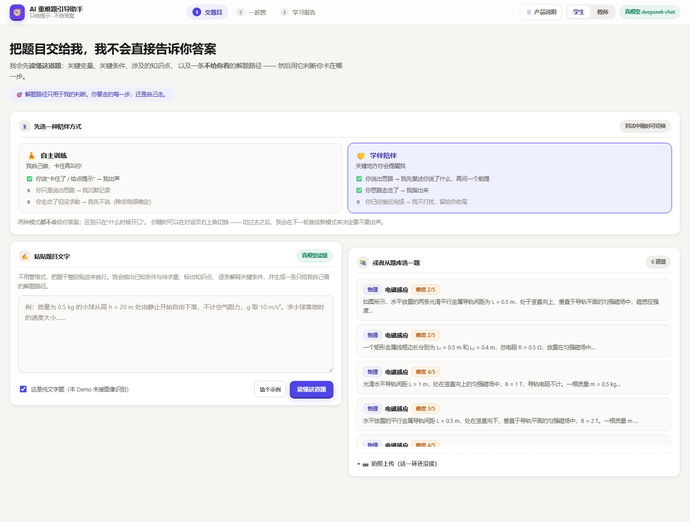
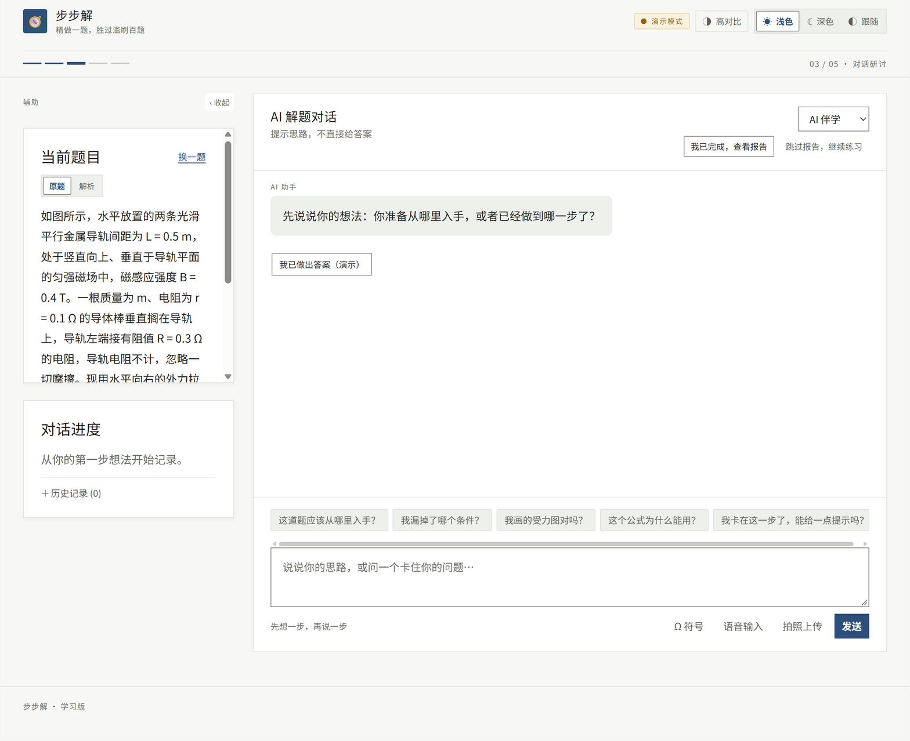
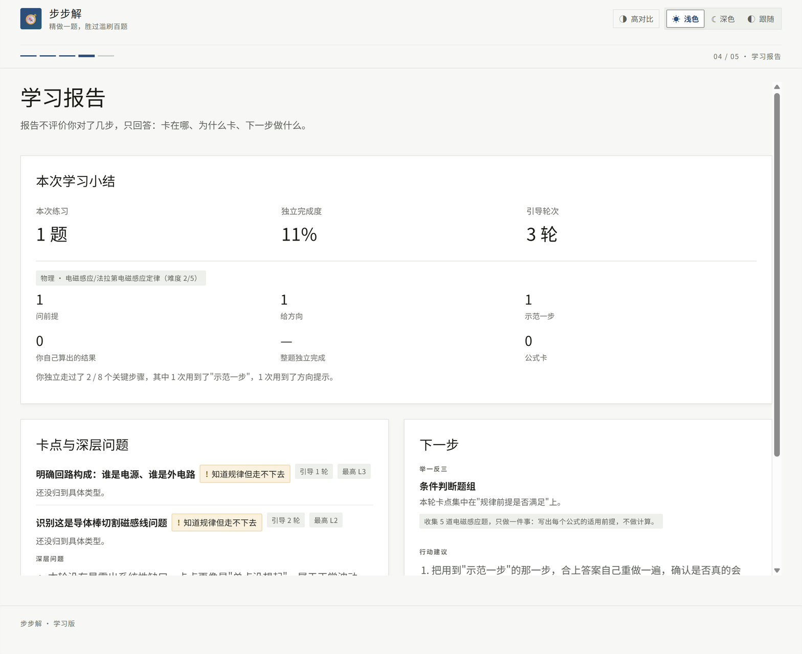

# 步步解

> 精做一题，胜过滥刷百题。

面向中学生重难题的引导式解题助手。它不直接回答“这道题怎么做”，而是先读懂学生已经想到哪一步，
再给出一句恰好够用的提示，逼学生自己往下走一步。

**正常模式不提供答案。** 只有第一页手动打开的“演示模式”，才会出现“我已做出答案”的演示入口。

[](package.json)
[](package.json)
[](test/run.js)
[](LICENSE)

仓库地址：<https://github.com/shilohjun/ai-guided-tutor>

<p align="center">
  
  
  <br />
  
</p>

---

## 目录

- [现在是什么](#现在是什么)
- [核心机制](#核心机制)
- [学习闭环](#学习闭环)
- [演示模式](#演示模式)
- [快速开始](#快速开始)
- [配置](#配置)
- [可用脚本](#可用脚本)
- [测试与评测](#测试与评测)
- [项目结构](#项目结构)
- [API 一览](#api-一览)
- [部署](#部署)
- [已知边界](#已知边界)
- [文档](#文档)
- [许可](#许可)

---

## 现在是什么

- **v3 学术界面**：五步流程——题目录入 → 解题方式 → 对话研讨 → 学习报告 → 迁移练习。
- **真实题库**：6 道内置题；点选走 `/api/problem`，粘贴文字走 `/api/problem/import`，拍照走 `/api/ocr`。
- **真实对话**：`/api/chat` 接入真实模型；学生消息、AI 提示、对话进度、完成判定都来自服务端。
- **真实报告**：`/api/report` 返回独立完成度、引导轮次、卡点、深层问题、推荐与行动建议。
- **公式卡**：`/api/formula` 在 L3 之后按知识点下发；报告单独统计公式卡次数并扣独立完成度。
- **学习历史**：localStorage 保存、刷新自动恢复、可搜索/恢复历史会话。
- **演示模式**：第一页开关；仅演示模式出现答案入口；演示会话不写入真实学习历史。
- **学生端不展示教师视图**：教师接口 `/api/teacher/*` 保留给教研，不在学生页面呈现。

---

## 核心机制

### 一、卡点分类体系

「学生卡住了」不是一个状态，而是七种完全不同的处境。诊断层必须把它们分开，
否则提示会答非所问——对“漏了前提”的学生追问“用什么规律”，等于白问。

| `stuckKind` | 学生处境 | 策略取向 |
|---|---|---|
| `not_started` | 还没形成思路 | 只做结构化澄清，不给任何方向 |
| `knowledge_gap` | 不知道用哪个规律 | 问过程性质，不点名公式 |
| `precondition_gap` | 知道规律但漏了前提 | 条件追问（最高价值场景） |
| `direction_lost` | 知道规律但走不下去 | 指关系、不指式子 |
| `execution_error` | 思路对但算错了 | 邀请自查，必要时局部示范 |
| `dead_end_path` | 自己已发现这条路走不通 | 引导换工具，而不是继续算 |
| `finished` | 已接近完成 | **AI 应当沉默** |

诊断结果必须能指回学生原话（`evidenceQuotes`），否则该次定位不被采信、
降级为“先澄清”。宁可先问一句“我理解得对吗”，也不对着错误的步骤给提示。

### 二、分层提示机制

提示分四层递进，**最多一次只升一级**：

| 层级 | 形态 | 内容 |
|---|---|---|
| `L0` | 结构化澄清 | 帮学生把话说清楚，不算提示 |
| `L1` | 条件追问 | 只问，不指方向 |
| `L2` | 方向提示 | 指出该看哪个量、哪个关系，但不给表达式 |
| `L3` | 降级示范 | 示范一步“动作”，不给数值结果 |

两条护栏不依赖模型自觉，而是在决策层强制生效：

- **禁止跳级**：按历史“连续前缀”判断可达层级，L3 要求历史里出现过 L2，L2 要求出现过 L1。
- **禁止原地打转**：同一层级在同一卡点已给过 2 次时，允许升一级；L3 再重复则要求学生复述自己的下一步。

### 三、防泄题机制

交付给学生的每一句话，都要先过七类确定性检查：

| # | 拦截内容 | 生效层级 |
|---|---|---|
| 1 | 数值答案（含“一库仑”这类中文数字说法） | 全部 |
| 2 | 解法性公式的完整表达式 | 全部（L3 允许“半边”） |
| 3 | 超出声明层级的内容（L1/L2 出现公式形态） | L0–L2 |
| 4 | 解法倾倒：编号步骤 > 2 个，或推导箭头 > 2 个 | 全部 |
| 5 | 收口句式：“所以答案是 / 最终结果 / 因此可得” | 全部 |
| 6 | 跑题：引用了本题不存在的概念 | 全部 |
| 7 | **说出解题核心结论**（如“导体棒是电源，r 是内阻”） | L0–L2 |

第 7 类判据是「**指派**」而非「提及」：

- ✅ 允许：*「谁是提供电动势的那一部分？它自身有没有电阻？」*
- ❌ 拦截：*「导体棒相当于电源，它的电阻就是内阻。」*

| 检查函数 | 违规 `kind` | 拦截内容 |
|---|---|---|
| `checkAnswerLeak` | `answer_in_text` | 数值答案 |
| `checkFormulaLeak` | `formula_leak` | 解法性公式表达式 |
| `checkLevelOverflow` | `level_overflow` | 超出声明层级的内容 |
| `checkSolutionDump` | `solution_dump` | 解法倾倒 |
| `checkConclusion` | `final_conclusion` | 收口句式 |
| `checkConceptDomain` | `concept_out_of_domain` | 跑题概念 |
| `checkSolutionInsight` | `solution_insight` | 解题核心结论 |

详细契约见 [`docs/01-hint-ontology-and-contract.md`](docs/01-hint-ontology-and-contract.md)
与 [`docs/02-prompt-spec.md`](docs/02-prompt-spec.md)。

---

## 学习闭环

1. **题目录入**：内置题库 / 文字导入 / 拍照识别；读题产出摘要、关键条件、知识点与知识图谱。
2. **解题方式**：AI 伴学或自主训练；两种方式都不会直接给答案。
3. **对话研讨**：学生先交出思路；服务端定位卡点、选层级、过守卫；完成时进入全屏恭喜页。
4. **学习报告**：三卡两列——小结（指标 + 帮助统计）、卡点与深层问题、下一步（推荐 + 行动）。
5. **迁移练习**：重做本题，或从真实题库里挑同知识点的题继续。

学生页面保留“我已完成，查看报告”和“跳过报告，继续练习”；报告支持 `?session=` 深链。
对话页支持 1440 宽度、可收起侧栏、符号浮层（`Ω 符号`）。

---

## 演示模式

演示模式是给现场演示用的，不是学生端功能。

- **入口**：题目录入页的“演示模式”开关。
- **正常模式**：对话里没有“我已做出答案”，不会返回本题答案。
- **演示模式**：masthead 出现“演示模式”标记；对话里出现“我已做出答案（演示）”。
- **点击后**：`/api/demo/answer` 返回本题最终结果（只给最终值，不给推导），
  显示一张“演示 · 参考答案”卡；卡上的“填入输入框”把学生口吻的答案填进输入框。
- **发送后**：仍走真实 `/api/chat`；引擎判定完成 → 恭喜页 → 报告。判定不通过就不硬跳。
- **隔离**：演示会话不写入 localStorage 学习历史。

当前演示答案只覆盖 `phy-emi-01` 到 `phy-emi-04` 四道内置题；其余题会明确提示暂无演示答案。

---

## 快速开始

需要 **Node.js 20 或更高版本**。项目**零运行时依赖**，无需 `npm install`：

```bash
git clone https://github.com/shilohjun/ai-guided-tutor.git
cd ai-guided-tutor
npm start
```

然后打开 <http://127.0.0.1:5173>。

没有配置模型 Key 也能完整跑通——引擎会自动降级到**离线规则桩**，
页面、测试、评测全部可用，只是提示文案来自规则而不是模型。

---

## 配置

复制 `.env.example` 为 `.env` 后按需填写。`.env` 已在 `.gitignore` 中，不会被提交。

| 变量 | 说明 | 默认 |
|---|---|---|
| `LLM_API_KEY` | 模型 API Key，留空即走离线规则桩 | 空 |
| `LLM_BASE_URL` | OpenAI 兼容接口地址（末尾不带 `/chat/completions`） | `https://api.deepseek.com/v1` |
| `LLM_MODEL` | 模型名 | `deepseek-chat` |
| `LLM_TIMEOUT_MS` | 单次请求超时，理科长题建议 ≥ 30s | `45000` |
| `PORT` / `HOST` | 本地服务地址 | `5173` / `127.0.0.1` |
| `TEACHER_KEY` | 教师接口口令（学生端不展示教师视图） | 空 |
| `ALIYUN_OCR_APPCODE` | 拍照识题凭据，留空则该入口显示“未启用” | 空 |

### 接入模型

任何兼容 OpenAI Chat Completions 协议的服务都可以：

```env
LLM_API_KEY=你的API密钥
LLM_BASE_URL=https://api.deepseek.com/v1
LLM_MODEL=deepseek-chat
```

### 拍照识题

拍照识题需要阿里云 OCR 云市场服务的 **AppCode**（不是 AppKey/AppSecret）：

```env
ALIYUN_OCR_APPCODE=你的AppCode
ALIYUN_OCR_PROVIDER=marketplace
```

图片识别**按成功调用次数计费**，且没有“额度用完自动停”的保护。
OCR 只识别题干文字，**不会自动理解受力图、电路图或几何图**；
流程刻意做成「识别 → 回填输入框 → 学生确认 → 再读题」，避免识别错误悄悄带偏整条链路。

---

## 可用脚本

```bash
npm start          # 启动本地服务
npm run dev        # 监听文件变化并重启
npm test           # 运行全部单元测试（当前 288 个注册用例）
npm run eval       # 离线评测（19 场景，无需 Key）
npm run eval:llm   # 使用 .env 中配置的模型重跑评测
npm run ocr:path   # 探测 OCR 链路连通性
npm run all        # 测试 + 离线评测
```

---

## 测试与评测

```bash
npm test
```

当前注册 **288 个用例**；**281 通过，7 条旧页面契约待迁移**：

- 2 条 OCR 路由契约（旧页面入口位置）；
- 3 条 DOM 契约（仍按旧 `app.js` 检查）；
- 2 条模式卡同步契约（v3 已改为单一模式选择器）。

这不是“全绿”状态；v3 新链路、`/api/formula` 与 `/api/demo/answer` 还没有独立测试。
`test/docs.test.js` 会从源码实际数出卡点种类、守卫类别与用例总数，再回头核对本文档。

```bash
npm run eval
```

在 **19 个教研标注场景**（物理 15、数学 4）上跑离线评测，输出泄题率、跳级率、
定位命中率、错因命中率等指标。切到真模型后**必须重跑**：

```bash
npm run eval:llm
```

> 评测口径与指标定义见 [`docs/03-evaluation-spec.md`](docs/03-evaluation-spec.md)。

---

## 项目结构

```text
public/
  index.html            v3 五步壳
  shell.css             v3 学术界面样式
  shell-overrides.css   对话/报告/演示模式覆盖
  youth.css             青春活力皮肤（只覆盖视觉层，不改页面结构与跳转）
  shell.js              真实题库、对话、报告、历史、演示模式
  mathinput.js          符号插入与自动替换
  app.js / styles.css   旧版页面，保留作迁移参考，当前不引用
src/core/
  engine.js             主流程编排
  locate.js             卡点定位
  route.js              分层提示与两条硬护栏
  guard.js              防泄题七类检查
  intake.js             读题（文字 → 结构化题目）
  ocr.js                拍照识题
  report.js             学习报告与会话记录
  formula-cards.js      公式卡知识点表
  demo-answers.js       演示模式最终答案表
src/server/             API 路由（本地与 serverless 共用）
test/                   自动化测试（自研极简运行器，零依赖）
docs/                   设计文档与截图
api/                    Vercel Serverless API 入口
showcase/               单文件成果展示页（独立于应用）
v3.html                  v3 设计参考稿
DESIGN-TOKENS.md         v3 设计 token 与可访问性说明
```

---

## API 一览

本地与 Vercel 环境复用同一份路由（`src/server/router.js`），行为不会漂移。

| 方法 | 路径 | 说明 |
|---|---|---|
| `GET` | `/api/health` | 健康检查与当前运行模式 |
| `GET` | `/api/problems` | 内置题目列表 |
| `GET` | `/api/problem?id=` | 单个题目（学生可见版本） |
| `POST` | `/api/problem/import` | 题目文字 → 结构化题目 |
| `POST` | `/api/ocr` | 题目照片 → 题干文本 |
| `POST` | `/api/chat` | 一轮引导对话（已过滤，不含解题路径与答案） |
| `GET` | `/api/report?sessionId=` | 学生学习报告 |
| `POST` | `/api/formula` | L3 之后按知识点取公式卡 |
| `POST` | `/api/demo/answer` | 演示模式的最终答案；普通学生端不调用 |
| `POST` | `/api/eval` | 触发评测 |
| `POST` | `/api/reset` | 重置会话 |
| `GET` | `/api/teacher/overview` | 教学汇总（需口令，学生端不展示） |
| `GET` | `/api/teacher/problem?id=` | 题目知识点与解题路径（需口令，学生端不展示） |
| `GET` | `/api/teacher/session?sessionId=` | 完整对话与 trace（需口令，学生端不展示） |

---

## 部署

仓库包含 Vercel 部署配置。**公开 Demo 默认关闭真模型、拍照 OCR 与教师视图**——
这个决定写在 `api/index.js` 里，而不是靠部署时“记得别配”：

- 公网服务带着 API Key 跑真模型，等于把额度挂出去；
- 拍照识题按次计费，删 Key 也拦不住已经发出去的调用；
- 教师接口返回完整解题路径与参考答案，挂在公开链接上等于把答案发出去。

确实需要在公网演示某一环时，必须显式设置对应开关（如 `PUBLIC_DEMO_ALLOW_OCR=1`），
并先阅读 `api/index.js` 中的限制说明。

### 三种可选形态

默认是"安全优先"的形态。想要更完整的演示效果，按需往上开一档：

| 形态 | 需要的环境变量 | 拿到的人能用到 |
|---|---|---|
| **默认**（不配任何变量） | 无 | 只有离线规则桩；OCR 与教师视图关闭 |
| **满血公开** | `PUBLIC_DEMO_FORCE_OFFLINE=0`<br>`PUBLIC_DEMO_ALLOW_OCR=1` | 真模型 + 拍照识题。**任何拿到链接的人都在消耗额度** |
| **口令门**（推荐） | 上面两个都不配<br>`DEMO_ACCESS_CODE=你的口令` | 带对口令（`?code=` 或请求头 `x-demo-code`）才是真模型 + OCR；<br>不带口令退回离线桩，页面照常可浏览 |

关于**口令门**的两个实现细节，因为它们直接决定它是否真的安全：

- **口令比较在服务端做**，用的是定时安全比较，前端拿不到口令本身；
  浏览器取到口令后存进 `localStorage` 并把它从地址栏抹掉，避免截图/投屏/转发泄露。
- **凭据按请求隔离**，不是改 `process.env`。后者是进程级的，两种形态共存时
  并发一交错就会串号——没带口令的请求会白捡上一个请求留下的真模型。
  实现见 `src/server/router.js` 的 `envFor()`（`AsyncLocalStorage`）。

> ⚠️ 选"满血公开"之前先想清楚成本：拍照识题**按成功调用次数计费**（约 0.083 元/次），
> 且没有"额度用完自动停"。建议先在阿里云控制台给该 AppCode 设额度上限或告警。
> 教师视图另由 `TEACHER_KEY` 控制，**口令门不放行它**——那接口返回完整解题路径与参考答案。

`showcase/` 是**独立的单文件展示页**，由
[`.github/workflows/pages.yml`](.github/workflows/pages.yml) 发布到 GitHub Pages；
它与可交互的应用页面相互独立。发布前需在仓库 Settings → Pages 中把 Source 设为
**GitHub Actions**。

---

## 已知边界

**现在这组数据证明的是「安全」，不是「有用」。**

- 它能证明：在 19 个场景与压力测试下，引擎**守得住不给答案**（泄题率 0%、跳级率 0%）。
- 它**还不能**证明：提示对学生的实际学习效果。这需要教研老师盲评真实对话才能判断。

其他已知限制：

| 限制 | 说明 |
|---|---|
| 测试状态 | 288 个注册用例中 281 通过；7 条旧页面契约待迁移，新链路无测试覆盖 |
| 演示答案范围 | 只覆盖 4 道内置物理题；其他题暂无演示答案 |
| 公式卡范围 | 按知识点表匹配；导入题的知识点不在表内时不发卡 |
| 场景集规模 | 19 个场景且由人编写，覆盖不了真实学生的表达多样性 |
| 长会话稳定性 | 场景集最长 3 轮，尚未做 10+ 轮疲劳测试 |
| 跨学科泛化 | 主要验证物理电磁感应，数学覆盖有限 |
| 图形类题目 | OCR 只识别文字，读不懂受力图、电路图与几何图 |
| 会话持久化 | 服务端会话存进程内存，重启后报告可能失效；浏览器只保存本地学习历史 |
| 教师视图 | 学生端已移除；`/api/teacher/*` 仅供教研接口使用 |
| 教学质量 | 未做教研盲评；这是下一阶段最重要的工作 |

---

## 文档

| 文档 | 内容 |
|---|---|
| [`01-hint-ontology-and-contract.md`](docs/01-hint-ontology-and-contract.md) | 提示本体与接口契约 |
| [`02-prompt-spec.md`](docs/02-prompt-spec.md) | Prompt 规范 |
| [`03-evaluation-spec.md`](docs/03-evaluation-spec.md) | 评测标准与方法 |
| [`04-intake-and-views.md`](docs/04-intake-and-views.md) | 读题链路与视图隔离 |
| [`05-ocr-feasibility.md`](docs/05-ocr-feasibility.md) | 图片识别可行性评估 |
| [`06-marketplace-ocr-integration.md`](docs/06-marketplace-ocr-integration.md) | 云市场题目 OCR 接入研究 |
| [`DESIGN-TOKENS.md`](DESIGN-TOKENS.md) | v3 设计 token 与可访问性说明 |
| [`showcase/`](showcase/) | 项目成果展示页 |

---

## 许可

项目当前标记为**未授权公开许可**（`UNLICENSED`）。如需复用或分发代码，请先联系项目作者。
